# Vibe

An AI website builder. You describe a website, an agent writes the Next.js code live in a cloud sandbox, and you watch it happen: the chat streams the agent's reasoning and every file it touches, while the preview shows the running site. You can then read the code, download it as a ZIP or export it to a GitHub repository. Usage is paid with credits.

This README explains the whole system: what each part does, how data moves, and why it is built that way. Read it top to bottom once and you should be able to find your way around any part of the code.

- `docs/plan.md` is the source of truth for scope, phases and open decisions.
- `docs/decisions.md` records every package and approach choice, with the alternatives that were rejected.
- `CLAUDE.md` (also linked as `AGENTS.md`) holds the working rules for anyone changing the code.

All diagrams are Excalidraw drawings in [`docs/diagrams/`](docs/diagrams/). Each has an editable `.excalidraw` source next to the rendered `.svg` (see [Editing the diagrams](#editing-the-diagrams)).

## Contents

1. [What Vibe does](#1-what-vibe-does)
2. [Architecture](#2-architecture)
3. [Tech stack](#3-tech-stack)
4. [Repository map](#4-repository-map)
5. [Data model](#5-data-model)
6. [Data flow](#6-data-flow)
7. [Sign-in and route protection](#7-sign-in-and-route-protection)
8. [From prompt to live preview](#8-from-prompt-to-live-preview)
9. [Inside the agent run](#9-inside-the-agent-run)
10. [Realtime events](#10-realtime-events)
11. [The workspace page](#11-the-workspace-page)
12. [Sandbox lifecycle](#12-sandbox-lifecycle)
13. [Guardrails](#13-guardrails)
14. [Credits and billing](#14-credits-and-billing)
15. [Export to GitHub](#15-export-to-github)
16. [API surface](#16-api-surface)
17. [Getting started](#17-getting-started)
18. [Environment variables](#18-environment-variables)
19. [Scripts](#19-scripts)
20. [Testing](#20-testing)
21. [Operations](#21-operations)
22. [Editing the diagrams](#editing-the-diagrams)

---

## 1. What Vibe does

| Step      | What the user sees                                                                  | What happens underneath                                                                                                                                 |
| --------- | ----------------------------------------------------------------------------------- | ------------------------------------------------------------------------------------------------------------------------------------------------------- |
| Sign in   | "Continue with GitHub"                                                              | Better Auth runs the GitHub OAuth flow and stores a database session                                                                                    |
| Prompt    | Home page prompt box with model picker, image attachments and voice input           | `project.create` stores the project and the first message, then enqueues an `agent/run` event                                                           |
| Build     | The workspace at `/p/[slug]`: chat on the left, a generating overlay on the right   | The `run-agent` Inngest function drives one **Builder** agent that writes files and runs commands in an E2B sandbox, streaming every step over realtime |
| Preview   | The running site in an iframe, plus a console of the agent's commands               | The sandbox runs `next dev` on port 3000 and serves a public preview URL                                                                                |
| Iterate   | Follow-up prompts, stop, retry, restore an older version                            | Each finished run saves a numbered **Version** (a snapshot of all files) and debits credits                                                             |
| Read code | Code mode: file tree, syntax-highlighted viewer, copy, single-file and ZIP download | Files come from the saved Version, not from the sandbox                                                                                                 |
| Export    | "Export to GitHub" creates or updates a public or private repo                      | The `export-github` Inngest function pushes the saved Version through the GitHub API                                                                    |
| Pay       | `/usage`: balance, daily usage chart, activity table, top-up from $5 to $100        | Stripe Checkout plus a signed webhook writes an append-only credit ledger                                                                               |

Pages: `/` (home), `/projects`, `/usage` and `/p/[slug]` (the workspace) need a session. `/sign-in`, `/terms`, `/privacy` and `/design` (the design system) are public.

## 2. Architecture

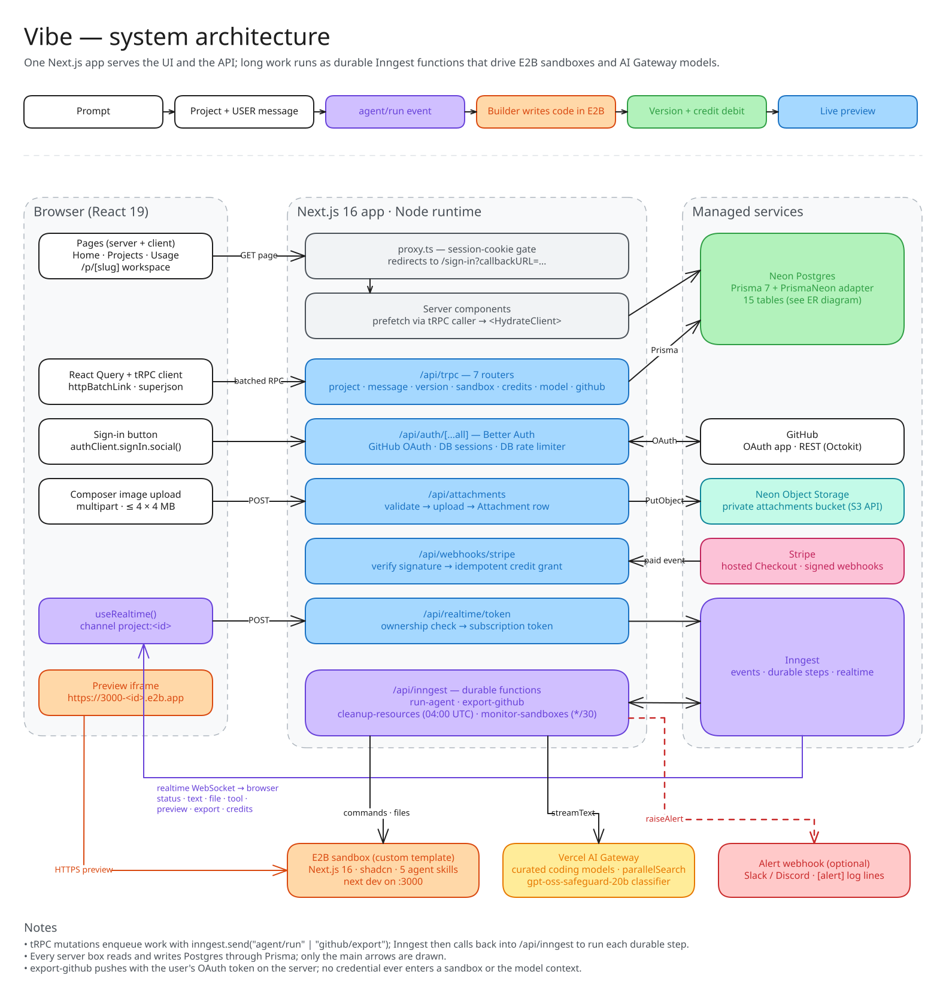

Vibe is **one Next.js 16 application**. It serves the pages, the tRPC API, a few route handlers, and the Inngest functions that do the long-running work. There is no separate backend service.

The key idea is the split between **request handlers** and **durable functions**:

- **Request handlers** (tRPC procedures and route handlers) are short. They check the session and ownership, apply rate limits, validate input, write to Postgres, and, for long work, enqueue an Inngest event. They never call a model or a sandbox directly, except `sandbox.wake` and `version.restore`, which are bounded and reserved per project.
- **Durable functions** (`run-agent`, `export-github`, `cleanup-resources`, `monitor-sandboxes`) run on Inngest. Inngest calls back into `/api/inngest` to execute each **step**, stores each step's result, and retries failed steps. A function that crashes halfway resumes from its last completed step instead of starting over, which matters for a build that may run for many minutes and hundreds of model calls.

Progress flows back to the browser through **Inngest realtime**: functions publish to a per-project channel (`project:<projectId>`), and the browser subscribes with `useRealtime` using a short-lived token from `/api/realtime/token`.

External services:

| Service                      | Used for                                                                                                                           |
| ---------------------------- | ---------------------------------------------------------------------------------------------------------------------------------- |
| **Neon Postgres**            | All application data, through Prisma 7 and the `PrismaNeon` driver adapter                                                         |
| **Neon Object Storage**      | Image attachments (private `attachments` bucket, S3 API)                                                                           |
| **Inngest**                  | Event queue, durable steps, cron schedules, realtime fan-out                                                                       |
| **Vercel AI Gateway**        | Every model call (curated list of coding models from several providers), web search, the guard classifier, and exact per-call cost |
| **E2B**                      | One sandbox per project, built from a custom Next.js template                                                                      |
| **GitHub**                   | OAuth sign-in and repository export (REST API through Octokit)                                                                     |
| **Stripe**                   | Hosted Checkout and signed webhooks for credit top-ups                                                                             |
| **Alert webhook** (optional) | Slack- or Discord-compatible incoming webhook for operational alerts                                                               |

## 3. Tech stack

| Concern                     | Choice                                                                                                 |
| --------------------------- | ------------------------------------------------------------------------------------------------------ |
| Framework                   | Next.js 16 (App Router, Turbopack, `proxy.ts` instead of middleware), React 19 with the React Compiler |
| Styling and UI              | Tailwind CSS 4 with CSS-variable design tokens, shadcn/ui on Base UI, AI Elements for chat components  |
| Data fetching               | tRPC v11 + TanStack React Query v5, `superjson`                                                        |
| URL state                   | `nuqs` (tabs, filters, selected file, device)                                                          |
| Database                    | PostgreSQL on Neon, Prisma 7 (client generated to `src/generated/prisma`)                              |
| Auth                        | Better Auth, GitHub OAuth only, database sessions                                                      |
| Background work             | Inngest v4 (durable functions, cron, built-in realtime)                                                |
| AI                          | AI SDK v7 through Vercel AI Gateway; own durable tool loop                                             |
| Sandbox                     | E2B with a custom template (`sandbox-templates/nextjs/`)                                               |
| Payments                    | Stripe Checkout (one-time, custom amount)                                                              |
| GitHub export               | `@octokit/rest` + `@octokit/plugin-retry`                                                              |
| Email                       | Resend (`resend` 6.38.1): build, failure and export notifications through an Inngest function          |
| Memory                      | Supermemory v5 (`supermemory` 5.1.2), read and written by code, never by the model                     |
| Guardrails                  | `@secretlint/core` + own patterns, `openai/gpt-oss-safeguard-20b` classifier, `npq` in the sandbox     |
| Env validation              | `@t3-oss/env-core` + `zod` (`src/config/env.ts`)                                                       |
| Tests                       | Vitest + Testing Library (unit and component), Playwright + axe (end-to-end and accessibility)         |
| Package manager and runtime | Bun for scripts, Node 24 for the app                                                                   |

Why each package was chosen, and what it beat, is in `docs/decisions.md`.

## 4. Repository map

```
.
├─ prisma/
│  ├─ schema.prisma              # 15 models (see Data model)
│  ├─ migrations/                # applied with bun run db:deploy
│  └─ seed.ts
├─ prisma.config.ts              # Prisma CLI config; points migrations at DIRECT_URL
├─ neon.ts                       # Neon infrastructure as code (the attachments bucket)
├─ sandbox-templates/nextjs/     # E2B template (Next.js 16 + shadcn + skills + AGENTS.md house rules) and blocks/ for generated sites
├─ scripts/                      # agent smoke test, block catalog, file-icon and model-logo generators
├─ e2e/                          # Playwright specs
├─ docs/
│  ├─ plan.md                    # phases, scope, env list, open decisions
│  ├─ agent-harness.md           # the agent pipeline (Phase 11)
│  ├─ decisions.md               # package and approach decision log
│  └─ diagrams/                  # the Excalidraw diagrams in this README
└─ src/
   ├─ proxy.ts                   # redirects signed-out users to /sign-in (cookie check only)
   ├─ app/
   │  ├─ (marketing)/            # /sign-in, /terms, /privacy (public)
   │  ├─ (app)/                  # sidebar shell: home, /projects, /usage
   │  ├─ (workspace)/p/[slug]/   # the workspace: chat, preview, code, export
   │  ├─ design/                 # /design, the living design system
   │  └─ api/
   │     ├─ auth/[...all]/       # Better Auth
   │     ├─ trpc/[trpc]/         # tRPC
   │     ├─ inngest/             # Inngest serve endpoint (all durable functions)
   │     ├─ attachments/         # image upload → Neon Object Storage
   │     ├─ realtime/token/      # realtime subscription token
   │     └─ webhooks/stripe/     # signed, idempotent payment fulfillment
   ├─ components/                # ui/ (shadcn), ai-elements/, workspace/, shell/, brand/, …
   ├─ config/env.ts              # typed environment
   ├─ inngest/
   │  ├─ client.ts, events.ts    # Inngest client and the typed agent/run and github/export events
   │  ├─ channels.ts             # realtime channel project:<id> and its topics
   │  ├─ functions/              # run-agent, export-github, maintenance (two crons)
   │  └─ agent/                  # router, planner, generator, verify/repair, loop, tools, executor, prompts, guardrails
   ├─ lib/                       # shared client/server helpers (message parts, file tree, search params…)
   ├─ server/
   │  ├─ db.ts, auth.ts, session.ts
   │  ├─ trpc/                   # init, context, routers
   │  ├─ ai/                     # AI Gateway client
   │  ├─ billing/                # balance, pricing, run cost, Stripe provider, fulfillment
   │  ├─ github/                 # export jobs, repository, files, errors
   │  ├─ sandbox/                # E2B helpers, path and command guards, recovery
   │  ├─ storage/                # attachments bucket
   │  ├─ ops/                    # alerts, cleanup, sandbox resume health
   │  └─ rate-limit.ts           # Postgres fixed-window limiter
   ├─ trpc/                      # client.tsx, server.tsx, query-client.ts
   └─ styles/globals.css         # design tokens
```

## 5. Data model

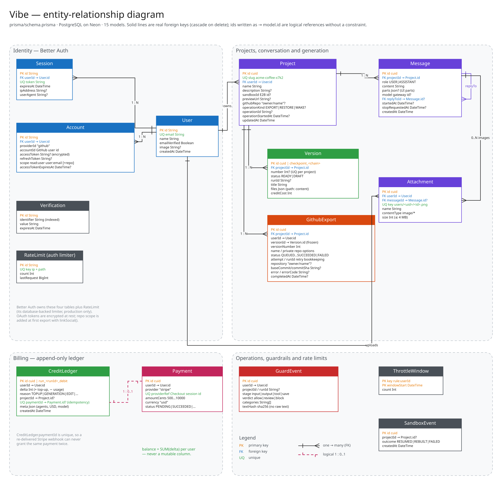

`prisma/schema.prisma` is the source of truth. The tables fall into four groups.

**Identity (Better Auth).** `User`, `Session`, `Account` and `Verification` are Better Auth's tables; `RateLimit` is its database-backed rate limiter, used in production. The GitHub `Account` row holds the encrypted OAuth tokens and the granted scopes. Sign-in asks only for `read:user user:email`; repository scope is added later, at the first export.

**Projects and generation.**

- `Project` belongs to a user and has a unique `slug` used in the URL. It remembers the current E2B `sandboxId` and `previewUrl` (both can be cleared at any time, because a sandbox can always be rebuilt), the exported `githubRepo`, and a short-lived **operation reservation** (`operationKind` = `EXPORT`, `RESTORE` or `WAKE`) that stops two of those from running on the same project at once.
- `Message` is one chat message, `USER` or `ASSISTANT`. `parts` is JSON for the rich UI (reasoning, tasks, tool calls, sources, guard notices). `model` is the model the user picked for that prompt. `replyToId` links a reply to its prompt; **a prompt with no reply is pending**, and a project is "building" while it has a pending prompt. `startedAt` and `stopRequestedAt` drive stop.
- `Attachment` is an uploaded image: the bucket `key`, type and size. `messageId` is empty until the prompt is sent; uploads that are never sent are deleted after a day.
- `Version` is a snapshot of every project file (`files` is `{ path: content }` JSON; small binaries are stored as data URLs). `READY` versions are numbered `v1, v2, …`. `DRAFT` versions are mid-run checkpoints with no number, used for recovery and replaced when the run finishes. `creditCost` is what the run that produced it cost.
- `GithubExport` is one export job: its options, status, attempt count, the **frozen** Version it exports, and the resulting repository and commit.

**Billing.** `CreditLedger` is append-only: `+` for top-ups and welcome credits, `−` for runs. **The balance is always `SUM(delta)`** for the user; there is no mutable balance column. `Payment` records each Stripe Checkout session. Two unique keys make payments idempotent: `Payment.providerRef` (the Checkout session id) and `CreditLedger.paymentId`.

**Operations.** `GuardEvent` logs guardrail decisions with a **hash** of the text, never the text itself. `ThrottleWindow` holds the per-user rate-limit counters. `SandboxEvent` records each sandbox resume, rebuild or failure for health alerts. `MemoryUsage` holds one row per month of memory usage and its estimated cost for the budget guard; `User.memoryEnabled` is the "Use memory" switch. `EmailUsage` counts notification emails per UTC day for the Resend limit; `User.notifyEmail` is the notifications switch.

Ids derived from the Inngest run id (`run_<runId>_reply`, `run_<runId>_debit`, `checkpoint_<chainId>`) make every write idempotent: a retried step can never create a second reply, version or charge.

## 6. Data flow

### Level 0: context

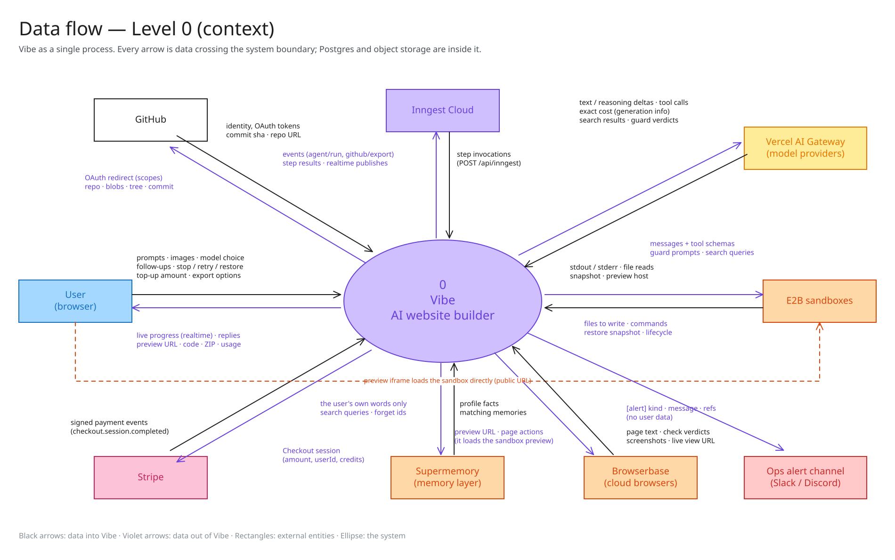

Seen from outside, Vibe exchanges data with the external parties below. Two flows are worth noticing: the browser loads the preview **directly** from E2B (sandbox preview URLs are public by design), and the alert channel only ever receives technical references, never user data.

### Level 1: processes and stores

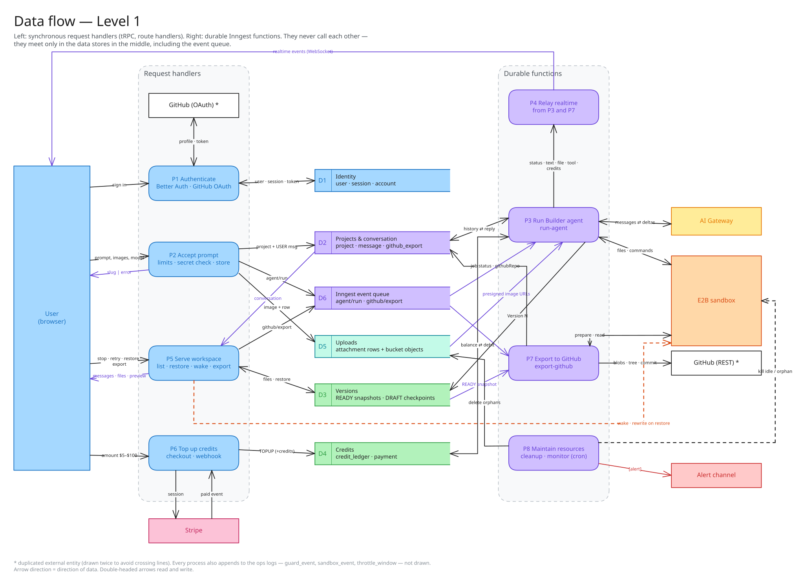

The left column is synchronous request handlers, the right column durable functions. **They never call each other.** They meet only in the data stores in the middle, and the Inngest event queue is treated as one of those stores. That is what makes the system robust: a request finishes in milliseconds and returns, while the work it started survives deploys, crashes and retries on its own.

| Process               | Code                                                     | Reads              | Writes                   |
| --------------------- | -------------------------------------------------------- | ------------------ | ------------------------ |
| P1 Authenticate       | `src/server/auth.ts`, `/api/auth`                        | D1                 | D1                       |
| P2 Accept prompt      | `project.create`, `message.send`, `/api/attachments`     | D2                 | D2, D5, D6 (`agent/run`) |
| P3 Run Builder        | `src/inngest/functions/run-agent.ts`                     | D2, D3, D4, D5, D6 | D2, D3, D4               |
| P4 Relay realtime     | `src/inngest/channels.ts`, `/api/realtime/token`         | —                  | —                        |
| P5 Serve workspace    | `message.*`, `version.*`, `sandbox.wake`, `github.start` | D2, D3             | D3, D6 (`github/export`) |
| P6 Top up credits     | `credits.checkout`, `/api/webhooks/stripe`               | —                  | D4                       |
| P7 Export to GitHub   | `src/inngest/functions/export-github.ts`                 | D3, D6             | D2                       |
| P8 Maintain resources | `src/inngest/functions/maintenance.ts`                   | D2, D5             | D2, D5                   |

## 7. Sign-in and route protection

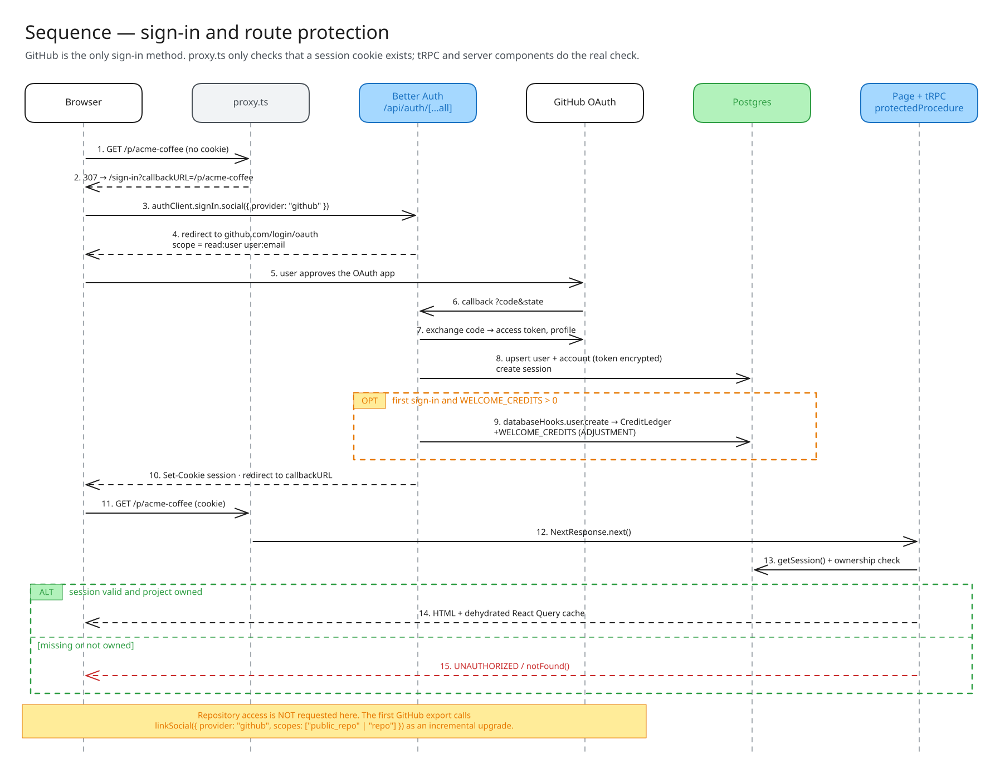

Protection has two layers:

1. **`src/proxy.ts`** (Next.js 16's replacement for middleware) runs on `/`, `/projects`, `/usage` and `/p/*`. It only checks that a session cookie **exists**, and otherwise redirects to `/sign-in?callbackURL=…`. It is fast and never touches the database.
2. **The authoritative check** happens in every tRPC procedure (`protectedProcedure` reads the Better Auth session and throws `UNAUTHORIZED`) and in server components and route handlers, which also check that the project belongs to the user. A missing or foreign project renders `not-found.tsx`.

On a user's first sign-in, a Better Auth database hook grants `WELCOME_CREDITS` as an `ADJUSTMENT` ledger row (nothing is written when it is 0).

## 8. From prompt to live preview

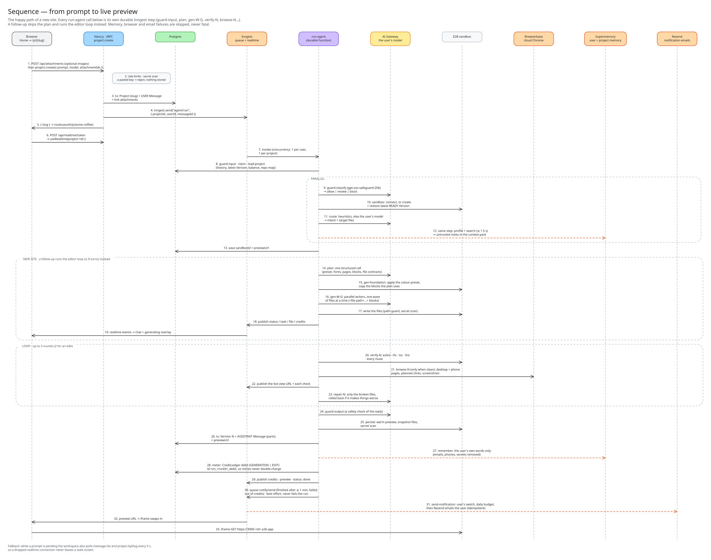

1. **Upload and create.** Images go to `POST /api/attachments` first, which validates them (PNG, JPEG, WebP or GIF, up to 4 images of 4 MB), stores them under `users/<userId>/<id>.<ext>` in the bucket and returns attachment ids. `project.create` then applies rate limits, **rejects any prompt containing a secret before anything is stored**, creates the project (name and unique slug derived from the prompt) and the first `USER` message, links the images, and sends `agent/run`.
2. **Subscribe.** The browser navigates to `/p/<slug>`, fetches a realtime token and subscribes to `project:<id>`.
3. **Run.** Inngest invokes `run-agent`, at most one run per user and one per project at a time, so concurrent projects cannot spend the same balance. Section 9 covers the steps in detail.
4. **Stream.** Every model delta and tool event is published to the channel and rendered live in the chat and the generating overlay.
5. **Save.** The run snapshots the sandbox into a new `Version`, writes the assistant reply, saves the preview URL and debits credits, then publishes `preview` and `status: done`. The preview iframe swaps in.

Follow-ups (`message.send`) follow the same path. Each follow-up is a new `USER` message and a new run; prompts sent while a build is running are queued.

## 9. Inside the agent run

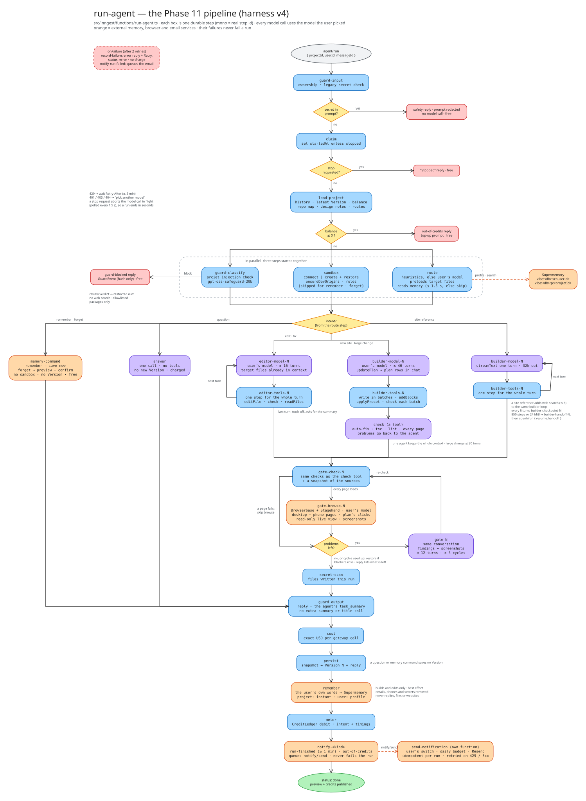

`run-agent` is a sequence of durable steps. The diagram and the steps below show the run after the Phase 11 harness (18 November 2026). The design is in [`docs/agent-harness.md`](docs/agent-harness.md).

**Early exits, never charged.** A legacy prompt with a secret, a prompt the user already stopped, an empty balance, or a `block` verdict from the guard classifier all end the run with a short reply and no model call that acts on the request.

**Setup in parallel.** `guard-classify`, `sandbox` and `route` run at the same time. `load-project` has already computed a repo map, design notes and the routes from the latest Version, on our server. The router uses heuristics, and asks the user's chosen model only when it's unsure, to pick an intent and the files the request most likely touches.

**One mode per intent.**

| Intent                                   | Steps                                                                                                                                                                                                                                                    |
| ---------------------------------------- | -------------------------------------------------------------------------------------------------------------------------------------------------------------------------------------------------------------------------------------------------------- |
| New site or large change                 | `plan`: one structured call returns preset, fonts, pages, blocks and file contracts. `gen-foundation`: code applies the colour preset and copies the ready-made blocks. `gen-<wave>-<group>`: parallel one-shot workers write files in dependency waves. |
| New site or change referencing a website | The builder loop, which has web search                                                                                                                                                                                                                   |
| Edit or fix                              | The editor loop (`editor-model-N`, `editor-tools-N`) with the target files already in its context, at most 8 turns                                                                                                                                       |
| Question                                 | `answer`: one call, no tools, no new version                                                                                                                                                                                                             |

Each loop turn is one model step and one tools step: all of a turn's tool calls run together, and read-only calls run in parallel. The tools are:

| Tool                  | Does                                                                                                                          |
| --------------------- | ----------------------------------------------------------------------------------------------------------------------------- |
| `editFile`            | Search-and-replace edits to an existing file: each block matches exactly once, all or nothing, with the same guards as writes |
| `createOrUpdateFiles` | Writes whole files (guarded paths, secret and tripwire scan, ≤ 20 files per call, ≤ 80 per run)                               |
| `readFiles`           | Reads files or line ranges (capped per file and per call)                                                                     |
| `listFiles`           | Lists project files by folder or glob                                                                                         |
| `searchCode`          | `grep` over the source, skipping dependencies, build output and env files                                                     |
| `terminal`            | Runs a command in `/home/user/app` (command guard, 3-minute timeout, output redacted and truncated)                           |
| `parallel_search`     | Web search through the gateway. Offered **only** when the prompt references a website (a URL or domain), at most 6 per run    |

**Verify and repair.**

1. `verify-N` first runs `eslint --fix` and adds a missing `"use client"`.
2. It then runs `tsc`, the ESLint rules that break behaviour, and a request to each route. Missing packages are installed and the checks run again.
3. When problems remain, `repair-N` gives them, with the affected files, to the editor for up to 6 turns. A new site gets 3 rounds and an edit gets 2.
4. A round that makes things worse is rolled back, and the reply lists anything still broken.

**Checkpoints and handoff.** Every 5 turns the working tree is scanned and saved as a `DRAFT` version. Inngest limits a run to about 1,000 steps and 32 MiB of state, so at 850 steps or 24 MiB the Builder writes a handoff note, the run saves a checkpoint, debits the work so far, and sends a new `agent/run` with `resume.handoff`. The next run restores the checkpoint and continues, with no chat message between the segments.

**Finishing.** The run scans the written files for secrets (one chance to fix) and checks the reply with the output guard. The reply comes from the plan's summary or the agent's own summary, and the title from the plan or the summary's first sentence: there are no extra model calls. The run asks the gateway for the **exact cost** of every call, persists the Version and reply in one transaction, and debits the ledger with the run's intent and per-phase timings (`bun run agent:smoke` prints them).

**Failures.** After two retries, `onFailure` writes an error reply with a Retry action and charges nothing. A 429 from a model waits for the gateway's `Retry-After` (up to 5 minutes); a 401, 403 or 404 stops with "the selected model isn't available, pick another".

## 10. Realtime events

One channel per project, `project:<projectId>`, typed with zod in `src/inngest/channels.ts`. Events are published only inside steps, because the function body replays.

| Topic       | Payload                                                                              | UI effect                                |
| ----------- | ------------------------------------------------------------------------------------ | ---------------------------------------- |
| `status`    | `{ state: thinking \| building \| compiling \| done \| stopped \| error, message? }` | Header badge and shimmer                 |
| `reasoning` | `{ turn, delta }`                                                                    | "Thought for N seconds" block            |
| `text`      | `{ turn, delta }`                                                                    | Streaming assistant text                 |
| `task`      | sandbox, install, read, file or note item (plan, checks, rollback)                   | Task list rows                           |
| `browser`   | `session` (live view URL), `check` (each page or interaction), `closed`              | Live browser view and checks list        |
| `file`      | `{ phase, path, verb, lines? }`                                                      | File chips and the generating overlay    |
| `tool`      | `{ phase, callId, name, command?, chunk?, exitCode? }`                               | Tool card and console                    |
| `search`    | `{ query, sources }`                                                                 | Sources list                             |
| `guard`     | `{ stage, verdict }`                                                                 | Blocked or restricted notice             |
| `credits`   | `{ used }`                                                                           | "N credits used"                         |
| `preview`   | `{ url }`                                                                            | Swaps the overlay for the preview iframe |
| `export`    | export job progress                                                                  | Export dialog and toolbar state          |

The same information is persisted in `Message.parts` (and `GithubExport` for exports), so a reload renders exactly what the live stream showed.

## 11. The workspace page

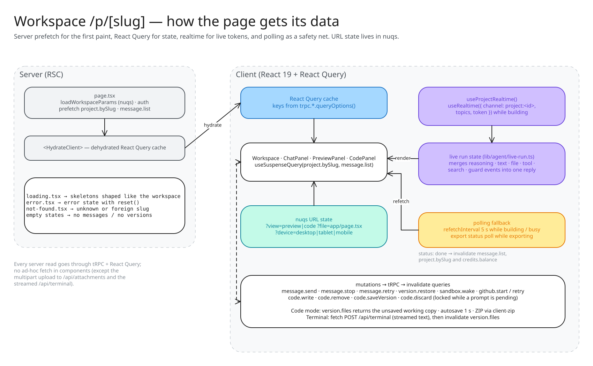

- The server component prefetches `project.bySlug` and `message.list` through a tRPC caller and hands the dehydrated React Query cache to the client with `<HydrateClient>`, so the first paint has data.
- The client reads with `useSuspenseQuery`. While a prompt is pending it subscribes to realtime **and** polls every 5 seconds, so a missed realtime event can never leave the page stuck.
- URL state lives in `nuqs`: `?view=preview|code`, `?file=…`, `?device=desktop|tablet|mobile`.
- Code mode reads `version.files` (no sandbox round trip), marks files Added or Modified against the previous version, and downloads ZIPs with `client-zip`. The latest version is **editable** (CodeMirror, autosave to the preview, locked while an agent runs) and a **terminal** runs commands in the sandbox; see [Editing and the terminal](#editing-and-the-terminal).
- On open, if nothing is building, `sandbox.wake` resumes the paused sandbox or rebuilds it (section 12) and shows "Waking up the preview…".
- Below 768 px the workspace switches to one full-screen view at a time (chat or preview) with a bottom bar; there is no Code mode on phones.

Every dynamic route has a skeleton `loading.tsx`, an `error.tsx` with retry, an explicit empty state and, for `/p/[slug]`, a `not-found.tsx`.

## 12. Sandbox lifecycle

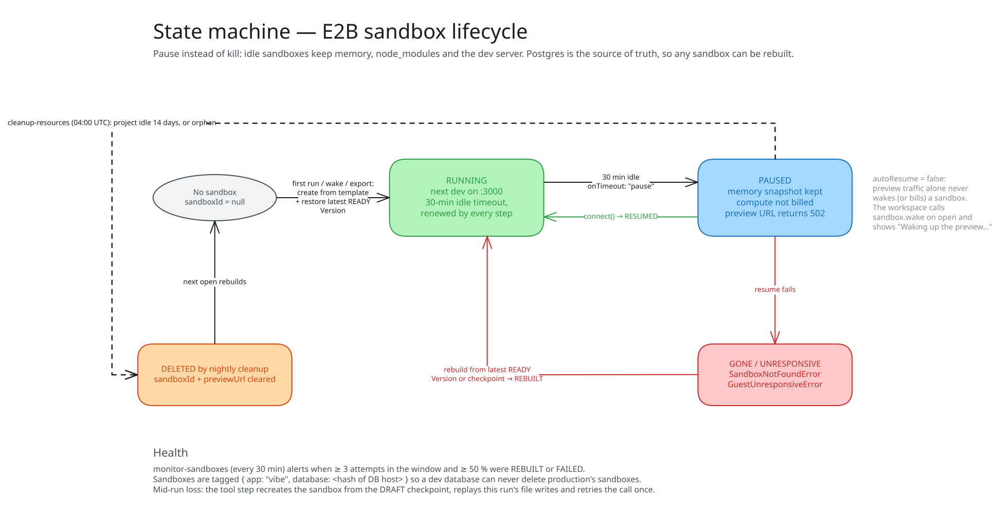

Each project has at most one E2B sandbox, built from the custom template in `sandbox-templates/nextjs/`: Node 24, a Next.js 16 app scaffolded with shadcn, all shadcn components, the five agent skills pinned by a committed lockfile (readable by the agent, and distilled into the house rules in `AGENTS.md`), and `next dev` already running on port 3000. The ready-made blocks in `sandbox-templates/nextjs/blocks/` are not in the image: the planner picks them and our code copies only those into a project.

- **Pause instead of kill.** Sandboxes are created with `lifecycle: { onTimeout: "pause", autoResume: false }` and a 30-minute idle timeout that every step renews. A paused sandbox keeps its memory, `node_modules` and dev server, and compute is not billed.
- **No accidental wake-ups.** `autoResume` is off, so preview traffic alone never wakes (or bills) a sandbox. Only a run, an export or `sandbox.wake` resumes it.
- **Always rebuildable.** Conversation, versions and credits live in Postgres. If a resume fails, a new sandbox is created and the latest `READY` Version (or the run's checkpoint) is restored into it. During a run, a tool step that finds the sandbox gone recreates it from the checkpoint, replays the run's writes and retries once.
- **Cleanup.** The nightly job deletes sandboxes of projects idle for 14 days, and paused sandboxes no project references. Sandboxes are tagged with a hash of the database host, so a development database can never delete production's sandboxes.

## 13. Guardrails

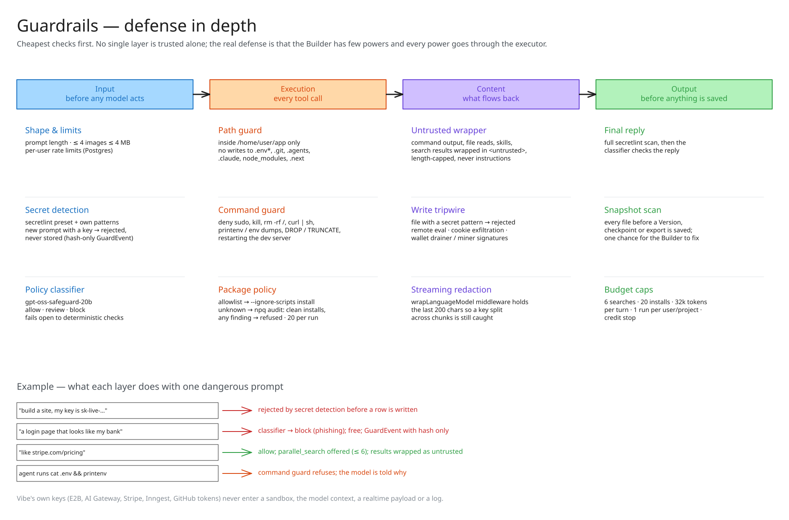

The rule underneath all of this: **no secrets in sandboxes or model context.** Vibe's own keys never enter a sandbox, and a secret a user pastes is rejected before it is stored.

| Layer                                                                                 | Where                                                        |
| ------------------------------------------------------------------------------------- | ------------------------------------------------------------ |
| Secret detection (`@secretlint/core` + own patterns)                                  | `src/inngest/agent/guardrails/scan.ts`, `secret-patterns.ts` |
| Policy classifier (`AI_GUARD_MODEL`): `allow`, `review` (restricted tools) or `block` | `guardrails/classifier.ts`, `prompts/guard.ts`               |
| Streaming redaction (`wrapLanguageModel` middleware with a 200-character hold-back)   | `guardrails/middleware.ts`, `redact.ts`                      |
| Untrusted-content wrapping                                                            | `guardrails/untrusted.ts`                                    |
| Path and command guards                                                               | `src/server/sandbox/guards.ts`                               |
| Package allowlist and `npq` audit                                                     | `guardrails/packages.ts`                                     |
| Code tripwire (remote eval, cookie exfiltration, miners)                              | `guardrails/tripwire.ts`                                     |

If the classifier is down it **fails open** to the deterministic checks and records `guard.input: "skipped"` in the ledger meta. Blocked prompts are never charged.

## 14. Credits and billing

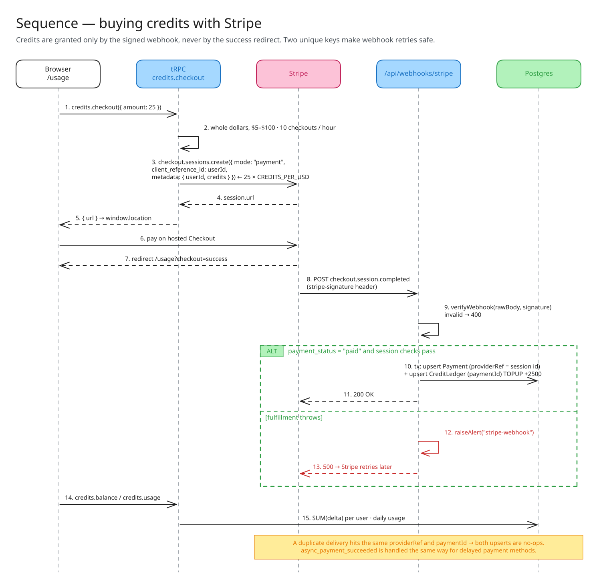

- **Price of a run:** `credits = ceil(cost in USD × CREDITS_PER_USD × CREDIT_MARKUP)`. The USD cost is the exact cost AI Gateway reports for every call (router, planner, file writers, builder or editor turns, repairs, answers, searches and the guard classifier; there are no separate summary or title calls); calls it cannot resolve fall back to a live-price estimate. The ledger `meta` lists the model, the USD cost, exact and estimated call counts, the run's intent and per-phase timings, and splits the cost by agent (`router`, `planner`, `generator`, `builder`, `editor`, `repair`, `answer` and `guard`).
- **What is free:** failed runs, blocked prompts, stopped prompts that never started, and out-of-credits replies. A stopped run is charged for the work it already did, because that work was paid for at the gateway.
- **Out of credits:** a run with a balance of 0 or less does not start. A running build stops when its running cost reaches the balance and keeps what it built.
- **Top-ups:** any whole-dollar amount from $5 to $100. `credits.checkout` creates a Stripe Checkout session with the credit amount frozen in signed metadata. Credits are granted **only** by the webhook, never by the success redirect. The fulfillment transaction upserts `Payment` by `providerRef` and `CreditLedger` by `paymentId`, so a re-delivered webhook is a no-op. A paid session that cannot be credited raises an alert and returns 500 so Stripe retries.

## 15. Export to GitHub

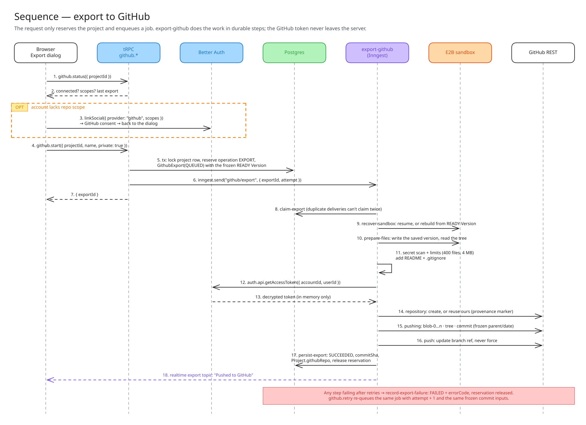

From a completed workspace, choose **Export to GitHub**. Connect GitHub to grant public repository access, or public and private access for private repositories. Review the repository name and visibility, then start the export. Private is selected initially. Re-export pushes the latest saved complete version to the same repository. The flow is the same on desktop and mobile.

How it works:

- `github.start` only validates, locks the project row, reserves an `EXPORT` operation, creates a `GithubExport` row (status `QUEUED`) that freezes the latest `READY` Version, and enqueues `github/export`. No request handler talks to GitHub.
- `export-github` (one per project at a time) recovers the sandbox, writes the saved version into it, reads and scans the files (secrets, 400 files, 4 MB), adds a README and `.gitignore`, then uses the Git Data API: blobs → tree → commit → update the branch ref. It never force-pushes over outside changes, and never overwrites an unrelated repository with the same name.
- The user's GitHub token is fetched with `auth.api.getAccessToken` inside the step and kept in memory. It never enters a step result, a sandbox, the model context or a realtime payload.
- "Pushed to GitHub" appears only after the result is persisted. Progress survives reloads through polling `github.status`, and failed jobs can be retried with the same frozen inputs.

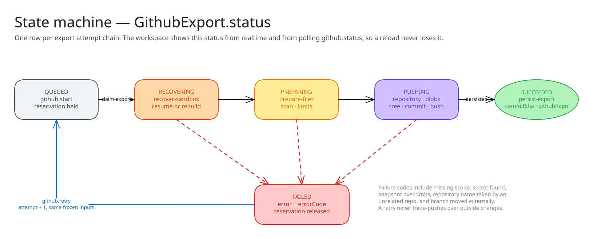

## 16. API surface

### tRPC procedures (`src/server/trpc/routers/`)

Every procedure requires a session and scopes its data to the caller. Mutations that start work are rate limited (`security.test.ts` fails if a mutation loses its limit).

| Router          | Procedures                                                                  |
| --------------- | --------------------------------------------------------------------------- |
| `project`       | `list`, `recent`, `bySlug`, `create`                                        |
| `message`       | `list`, `send`, `stop`, `retry`                                             |
| `version`       | `list`, `files`, `restore`                                                  |
| `sandbox`       | `wake`                                                                      |
| `credits`       | `balance`, `usage`, `checkout`                                              |
| `model`         | `list` (curated models intersected with the gateway's live list and prices) |
| `github`        | `status`, `start`, `retry`                                                  |
| `memory`        | `list`, `setEnabled`, `forget`, `clear`                                     |
| `notifications` | `get`, `setEnabled`                                                         |
| `code`          | `write`, `remove`, `saveVersion`, `discard`                                 |

### Route handlers (`src/app/api/`)

| Route                         | Purpose                                                 |
| ----------------------------- | ------------------------------------------------------- |
| `GET/POST /api/auth/[...all]` | Better Auth (sign-in, callback, sessions, link account) |
| `POST /api/trpc/[trpc]`       | tRPC                                                    |
| `POST /api/attachments`       | Image upload to Neon Object Storage                     |
| `POST /api/terminal`          | Streams a command run in the project's sandbox          |
| `POST /api/realtime/token`    | Realtime subscription token for one project             |
| `POST /api/webhooks/stripe`   | Signed Stripe events                                    |
| `GET/POST/PUT /api/inngest`   | Inngest serve endpoint                                  |

### Inngest functions (`src/inngest/functions/`)

| Function            | Trigger               | Concurrency               |
| ------------------- | --------------------- | ------------------------- |
| `run-agent`         | event `agent/run`     | 1 per user, 1 per project |
| `export-github`     | event `github/export` | 1 per project             |
| `cleanup-resources` | cron `0 4 * * *`      | —                         |
| `monitor-sandboxes` | cron `*/30 * * * *`   | —                         |
| `send-notification` | event `notify/send`   | 3                         |

### Rate limits (per user, `src/server/rate-limit.ts`)

| Action                                                                     | Limit              |
| -------------------------------------------------------------------------- | ------------------ |
| Agent starts (`project.create`, `message.send`, `message.retry` together)  | 20 per 10 minutes  |
| `project.create`                                                           | 10 per hour        |
| `credits.checkout`                                                         | 10 per hour        |
| `github.start`, `github.retry`                                             | 10 per hour        |
| `sandbox.wake`                                                             | 30 per 10 minutes  |
| `version.restore`                                                          | 20 per 10 minutes  |
| `memory.setEnabled`, `memory.forget`, `memory.clear` (together)            | 30 per 10 minutes  |
| `code.write`, `code.remove`, `code.saveVersion`, `code.discard` (together) | 600 per 10 minutes |
| `POST /api/terminal`                                                       | 60 per 10 minutes  |
| `notifications.setEnabled`                                                 | 30 per 10 minutes  |
| `POST /api/attachments`                                                    | 40 per 10 minutes  |
| `POST /api/realtime/token`                                                 | 120 per 10 minutes |

Limits are fixed-window counters in Postgres (`ThrottleWindow`, one atomic upsert per request). tRPC answers `TOO_MANY_REQUESTS` with a readable wait; route handlers answer 429 with `Retry-After`. Sign-in endpoints use Better Auth's own database-backed limiter in production.

## 17. Getting started

1. Use Node 24 (`nvm use`, from `.nvmrc`) and install dependencies with `bun install`.
2. Copy `.env.example` to `.env` and fill it in. Each variable is described there and in [section 18](#18-environment-variables).
3. Apply the database migrations with `bun run db:deploy` (or `bun run db:migrate` while developing).
4. Build the sandbox template once with `bun run sandbox:build` and paste the printed id into `E2B_TEMPLATE_ID`.
5. Start the app with `bun run dev` and open <http://localhost:3000>. In a second terminal run `bun run inngest:dev` so the agent runs.

Notes:

- Local development targets the Neon `development` branch; production has not been migrated. Keep local database URL overrides aligned in `.env` and `.env.local`, since Prisma and Next.js load their environments differently.
- If the local Inngest server uses a port other than 8288, set `INNGEST_DEV` to its full address (for example `http://localhost:8290`).
- To test top-ups locally, forward Stripe events to `/api/webhooks/stripe` with the Stripe CLI and put its signing secret in `STRIPE_WEBHOOK_SECRET`.

## 18. Environment variables

`src/config/env.ts` is the source of truth. Any change to it also updates `.env.example`, the list in `docs/plan.md` and the test env in `vitest.config.mts`.

| Variable                                                                          | Purpose                                                                  |
| --------------------------------------------------------------------------------- | ------------------------------------------------------------------------ |
| `NEXT_PUBLIC_APP_URL`                                                             | Public base URL (Stripe redirect URLs)                                   |
| `DATABASE_URL`                                                                    | Pooled Neon URL, used by Prisma Client through the Neon adapter          |
| `DIRECT_URL`                                                                      | Direct Neon URL, used by `prisma.config.ts` for migrations               |
| `BETTER_AUTH_SECRET`, `BETTER_AUTH_URL`                                           | Better Auth signing secret and base URL                                  |
| `GITHUB_CLIENT_ID`, `GITHUB_CLIENT_SECRET`                                        | GitHub OAuth app (callback `<BETTER_AUTH_URL>/api/auth/callback/github`) |
| `WELCOME_CREDITS`                                                                 | Credits granted once on first sign-in (0 disables)                       |
| `AI_GATEWAY_API_KEY`                                                              | Vercel AI Gateway key                                                    |
| `AI_DEFAULT_MODEL`                                                                | Default model; must be in `src/lib/ai/models.ts`                         |
| `AI_GUARD_MODEL`                                                                  | Guardrail classifier model                                               |
| `CREDITS_PER_USD`, `CREDIT_MARKUP`                                                | Credit pricing                                                           |
| `E2B_API_KEY`, `E2B_TEMPLATE_ID`                                                  | Sandboxes                                                                |
| `AWS_ACCESS_KEY_ID`, `AWS_SECRET_ACCESS_KEY`, `AWS_ENDPOINT_URL_S3`, `AWS_REGION` | Neon Object Storage (written by `neon deploy`)                           |
| `INNGEST_DEV`, `INNGEST_EVENT_KEY`, `INNGEST_SIGNING_KEY`                         | Inngest (dev server locally, keys in production)                         |
| `STRIPE_SECRET_KEY`, `STRIPE_WEBHOOK_SECRET`                                      | Stripe Checkout and webhooks                                             |
| `ALERT_WEBHOOK_URL`                                                               | Optional Slack- or Discord-compatible alert webhook                      |
| `SUPERMEMORY_API_KEY`, `AGENT_MEMORY`, `MEMORY_MONTHLY_USD`                       | Memory: key (empty turns memory off), `on`/`off`, monthly budget in USD  |
| `RESEND_API_KEY`, `EMAIL_FROM`, `EMAIL_NOTIFICATIONS`, `EMAIL_DAILY_LIMIT`        | Email: key (empty turns email off), sender, `on`/`off`, daily limit      |

## 19. Scripts

| Command                                            | What it does                                       |
| -------------------------------------------------- | -------------------------------------------------- |
| `bun run dev` / `build` / `start`                  | Run, build and serve the app                       |
| `bun run lint`                                     | ESLint                                             |
| `bun run format`                                   | Prettier on the whole repo                         |
| `bun run test` / `test:run`                        | Vitest in watch mode / once                        |
| `bun run test:e2e`                                 | Playwright (set `E2E_PORT` if port 3000 is in use) |
| `bun run db:generate` / `db:migrate` / `db:deploy` | Prisma client and migrations                       |
| `bun run db:seed` / `db:studio`                    | Seed data and Prisma Studio                        |
| `bun run inngest:dev`                              | Local Inngest dev server pointed at the app        |
| `bun run sandbox:build`                            | Build the E2B template and print its id            |
| `bun run agent:smoke`                              | End-to-end smoke test of a real agent run          |
| `bun run icons:generate` / `logos:generate`        | Regenerate the file-type icons and model logos     |
| `bun run clean`                                    | Remove build and test artifacts                    |

## 20. Testing

- **Unit and component tests** (Vitest + Testing Library) live next to the code as `*.test.ts(x)`. They cover the agent loop, tools and executor, guardrails (including a test that no secret can reach a model, a log or a snapshot), billing and fulfillment, rate limits, cleanup, the GitHub export job, every tRPC router's security, and the main components.
- **End-to-end tests** (Playwright, Chromium, Firefox and WebKit) are in `e2e/`: auth, home, projects, create flow, workspace, realtime, usage, billing (Stripe test mode: signed events credit once, tampered or unpaid events credit nothing), GitHub export, hardening (rate limits and security headers), theme, public pages and accessibility (axe, WCAG 2 A/AA in light and dark).
- Browser tests stub paid services (E2B sandboxes, model calls). A real generation is covered by `bun run agent:smoke`.

## 21. Operations

- **Rate limits.** Per user and enforced in Postgres (see [section 16](#rate-limits-per-user-srcserverrate-limitts)).
- **Nightly cleanup** (Inngest cron, 04:00 UTC): deletes sandboxes of projects idle for 14 days (they rebuild from the latest saved version when opened), unreferenced paused sandboxes of this database, uploads never sent with a message after a day, and expired counters. Every sweep is capped per run.
- **Sandbox health** (every 30 minutes): alerts when at least 3 resumes happened in the window and half or more were rebuilds or failures.
- **Alerts.** Set `ALERT_WEBHOOK_URL` to a Slack- or Discord-compatible incoming webhook to receive them; without it they are only written to the server log as `[alert]` lines. They fire when a paid Stripe session can't be credited, when sandbox resumes fail or fall back to rebuilds, and when the nightly cleanup can't remove something.
- **Where to look.** The Inngest dashboard shows agent runs, exports and the two scheduled functions; the server log has `[alert]`, `[trpc]` and `[run-agent]` lines.
- **Security headers** on every response: `nosniff`, `X-Frame-Options: SAMEORIGIN`, a strict `Referrer-Policy`, a `Permissions-Policy` that keeps the microphone for voice input, and HSTS. There is no Content-Security-Policy yet (see `docs/plan.md`, Phase 9).
- **Migrations.** Apply `bun run db:deploy` before deploying a version that adds migrations (the latest is `20261114180945_phase_9_hardening`).

## Editing the diagrams

Every diagram in this README lives in [`docs/diagrams/`](docs/diagrams/) as a pair:

- `<name>.excalidraw`: the editable source. Open it at [excalidraw.com](https://excalidraw.com) (menu → Open) or with the Excalidraw VS Code extension.
- `<name>.svg`: the rendered image this README embeds, with fonts included.

After editing, export the SVG from Excalidraw (Export image → SVG, background on) over the old file, so the two stay in sync.

| Diagram                           | Files                         |
| --------------------------------- | ----------------------------- |
| System architecture               | `architecture`                |
| Entity-relationship               | `er`                          |
| Data flow, levels 0 and 1         | `dfd-context`, `dfd-level1`   |
| Sign-in sequence                  | `seq-auth`                    |
| Generation sequence               | `seq-generation`              |
| Editing and terminal sequence     | `seq-edit`                    |
| run-agent pipeline                | `agent-pipeline`              |
| Workspace data flow               | `workspace-client`            |
| Sandbox lifecycle                 | `sandbox-lifecycle`           |
| Guardrails                        | `guardrails`                  |
| Stripe top-up sequence            | `seq-topup`                   |
| GitHub export sequence and states | `seq-export`, `export-states` |

## Browser checks and live viewing

Browserbase cloud Chrome, driven by Stagehand v4, checks generated pages on desktop (1280 × 800) and phone (390 × 844). Stagehand model calls use the selected model through AI Gateway. Set the server-only `BROWSERBASE_API_KEY`; `AGENT_BROWSER_QA=on` is the default, and `off` disables checks. Missing credentials or provider failures produce a skipped report rather than claiming the site passed.

The workspace preview shows a read-only live browser and streamed page/interaction results. On mobile, “Watch the browser check the site” opens the preview pane. The viewer accepts only HTTPS `www.browserbase.com` fullscreen URLs; pointer and keyboard interaction are disabled. A disconnected viewer can be retried while check results continue streaming. The completed chat message retains check results and desktop/phone screenshot thumbnails with expandable dialogs.

Screenshots are stored in Neon Object Storage and served through signed URLs after project ownership checks. The nightly cleanup targets screenshots older than 30 days; project deletion also deletes them. Saved check text remains with the conversation after screenshots expire. Browserbase session recording is disabled by the provider adapter; this does not promise deletion of Browserbase operational logs. Browserbase receives the preview address and rendered page content; Stagehand page context is processed through AI Gateway. Privacy and Terms changes need owner review before release.

The diagrams show the browser checks: `browse-N` in `agent-pipeline` and `seq-generation`, Browserbase and its read-only live view in `architecture`, and Browserbase as an external entity in both data-flow levels. Screenshot storage is not drawn separately (it is the existing Neon Object Storage). No visual critic or user browser takeover is included.

Validation: component tests cover embed restrictions, disconnect/retry, check states and saved screenshots. Realtime Playwright coverage needs `DATABASE_URL`, `BETTER_AUTH_SECRET` and a running Inngest dev server; paid Browserbase credentials are unnecessary for its mocked viewer. A real cloud-session smoke run additionally requires `BROWSERBASE_API_KEY` and the existing gateway/sandbox/storage credentials.

## Memory

Vibe remembers each user's preferences across projects and each project's corrections and decisions, using Supermemory v5. Only the user's own message text is stored (emails and phone numbers removed, messages that look like they hold a secret skipped); agent replies, files, websites and tool output never are. Code reads memory in the agent's `route` step (1.5 s timeout, skipped on failure) and adds it to the context pack as untrusted notes ranked below the current message, the files and the project; the model has no memory tools. Namespaces are `vibe:<db>:u:<userId>` and `vibe:<db>:p:<projectId>`, built only by code.

Users manage memory under **Memory** in the account menu (list, forget one, clear all, the "Use memory" switch, on by default), or in chat with "remember that…" and "forget that…" (forgetting always asks for confirmation). Deleting a project drops its memory. A monthly guard (`MemoryUsage`) stops writes at 80% of `MEMORY_MONTHLY_USD` and reads at 100%, and alerts once.

Set `SUPERMEMORY_API_KEY` and apply the `20261118120000_memory_layer` migration to turn it on. Supermemory is disclosed in the Privacy Policy and Terms, pending the owner's review. Details are in `docs/agent-harness.md`.

## Email notifications

Vibe emails a user when a build finishes after a minute or more, fails or runs out of credits, and when a GitHub export finishes or fails, through Resend. `run-agent` and `export-github` queue a small `notify/send` event; the `send-notification` function loads the user and project, applies the rules (the user's switch, a daily budget, no email for quick builds), renders the message and sends it with an idempotency key, so a retry never sends twice. A failed send can never affect a build. Emails contain the project name, the outcome and a link, never prompts, code or files. Users switch them off under **Notifications** in the account menu (`User.notifyEmail`, on by default).

Set `RESEND_API_KEY` and apply the `20261119090000_email_notifications` migration to turn it on. `EMAIL_FROM` defaults to Resend's free `onboarding@resend.dev` sender, which only delivers to the email address of your own Resend account; verify a domain at resend.com/domains and change `EMAIL_FROM` to reach every user. The free plan allows 100 emails a day: finished-build and export emails stop at 80% of `EMAIL_DAILY_LIMIT`, failure emails at 100%, with one alert a day. Resend is disclosed in the Privacy Policy and Terms, pending the owner's review.

## Editing and the terminal

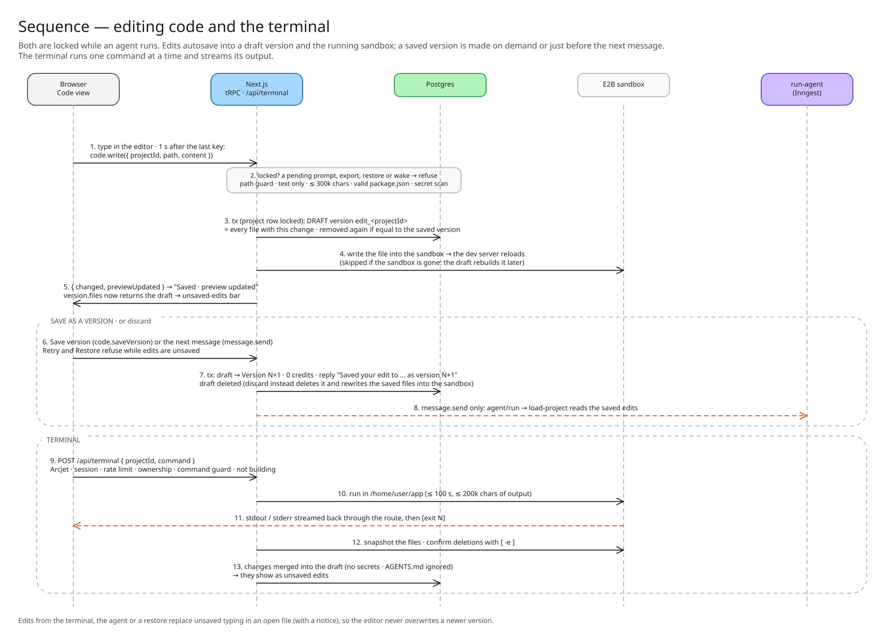

The Code view of the latest version is an editor (CodeMirror 6, loaded only when a file is opened), and a terminal is one click away. Both lock while an agent is running, and both are unavailable on phones.

- **Edits** autosave about a second after typing stops (⌘S saves at once). Each edit is checked on the server (path guard, text files only, size limit, secret scan, valid `package.json`), saved into a draft version (`DRAFT`, id `edit_<projectId>`, holding every file) and written to the running sandbox, so the preview reloads. A lost sandbox is rebuilt from the draft, so edits are never only in the sandbox.
- **Versions.** A bar shows "unsaved edits" with **Save version** and **Discard**. Sending the next message saves the edits as the next version first (0 credits, "Edited <file>"), so the agent always works from them. Retry and Restore wait until the edits are saved or discarded. GitHub export uses saved versions, so save first.
- **Terminal.** `POST /api/terminal` streams the output of one command run in the project's sandbox (100 second timeout, 200,000 characters of output, the agent's command guard: no `sudo`, no starting or stopping the dev server, no `kill`, no destructive deletes). It is a command runner, not a full terminal: no interactive programs and no cancel. Files a command changes (for example `npm install zod`) become unsaved edits.
- **Not yet:** creating, renaming and deleting files from the tree, inline error markers, format on save, and AI inline edit. Design and decisions: `docs/plan.md` §6.7 and `docs/decisions.md`.
