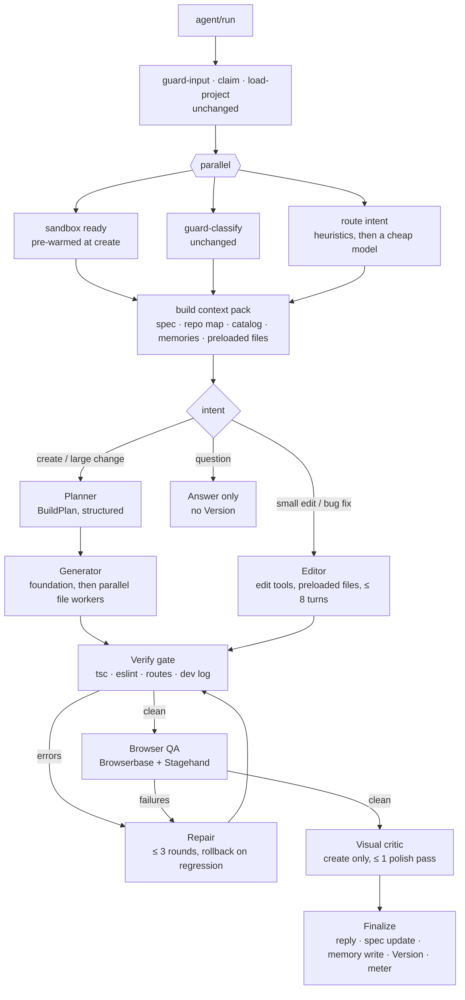

# Agent v2 — a fast, self-verifying builder (Phase 11 design)

**Status: approved, 15 November 2026 (memory layer added the same day, §17). Nothing here is built.** The owner answered every open decision (§15). The build order, in small phases, is in [`docs/plan2.md`](plan2.md). Once approved, this file is the detailed design behind Phase 11 in `docs/plan.md`. The plan's ground rules still apply: package-first (§0.1), no secrets in sandboxes or model context, UI only from `~/Desktop/vibe-ui`, and the test and docs rules in `CLAUDE.md`.

**Goal:** a first prompt gives a complete, working, good-looking multi-page app. A small follow-up edit finishes in under a minute and changes only what was asked. The agent proves its work in a real browser before it says it is done.

---

## 1. Diagnosis: why today's Builder is slow and buggy

Every point below comes from reading the current code, not from guessing.

| #   | Symptom                           | Root cause in the code                                                                                                                                                                                                                                                                                                                                                                                          | Fixed by       |
| --- | --------------------------------- | --------------------------------------------------------------------------------------------------------------------------------------------------------------------------------------------------------------------------------------------------------------------------------------------------------------------------------------------------------------------------------------------------------------- | -------------- |
| 1   | Slow everywhere                   | **Rate limit.** The free gateway tier allows 5 requests per minute per model. Every Builder turn is one request, and the summary, title and guard calls add more. A 25-turn build spends at least 5 minutes just waiting, and a 429 makes Inngest wait up to 5 minutes (`RetryAfterError` in `loop.ts`). No architecture makes this Lovable-fast. Making fewer calls is the only lever that doesn't cost money. | §7, §8, §15.1  |
| 2   | Half-built apps                   | **One small model does everything in one open-ended loop.** `gpt-5.1-codex-mini` is asked to design, plan, write, debug and decide when it's finished, with no written plan and no turn structure. Products like Lovable and v0 split this up: a strong model plans and writes, fast models apply edits and repairs, and opinionated scaffolding does a lot of the work.                                        | §5.3–5.5, §7   |
| 3   | Wasted turns on every request     | **Ceremony.** `skillGate` (`execute-tool.ts`) rejects the first write until the model has read `AGENTS.md` and loaded a skill, even for a one-line edit. The skills are long general essays that crowd out the project in a small model's context.                                                                                                                                                              | §5.2, 11.1     |
| 4   | Slow edits that break other code  | **Whole-file rewrites only.** `createOrUpdateFiles` is the only way to write. Changing one line means sending the whole file back, which costs output tokens and therefore time. Small models drop or alter unrelated code while copying, which causes the regressions in follow-ups.                                                                                                                           | §5.6           |
| 5   | Follow-ups don't know the project | **No project memory.** `historyToMessages` (`conversation.ts`) passes the last 20 chat texts and a flat list of file paths. Each follow-up re-reads files to find out what exists, which costs turns and misses design decisions made earlier.                                                                                                                                                                  | §5.2           |
| 6   | Many bugs in the finished app     | **Checking is optional and shallow.** The run ends whenever the model stops calling tools. The model may run `tsc` or `curl`, or skip both. Nothing checks lint, the dev-server log, runtime or hydration errors, console errors, broken buttons, mobile layout or how the page looks. The Builder never sees its own app.                                                                                      | §5.7, §5.8, §6 |
| 7   | Generic, uneven design            | **Blank canvas.** The template's page says "Project ready!" and the agent writes every navbar, hero and pricing table from scratch, every time.                                                                                                                                                                                                                                                                 | §10            |
| 8   | Overhead between turns            | **Sequential durable steps.** When the model asks for several tools at once, each still runs as its own sequential `step.run` (`loop.ts`). Each turn adds another step just to check for Stop. Summary and title are two more model calls at the end, which cost about 24 s on the free tier on their own.                                                                                                      | §8             |
| 9   | Tokens bought again every turn    | **The context changes from the front.** `compactHistory` rewrites the turn that falls out of the last-three window. Everything after it changes, so the provider's prompt cache misses for the rest of the history.                                                                                                                                                                                             | §5.2           |

**Read this before anything else:** points 1 and 2 are about money (the gateway tier and the model). Points 3–9 are design problems that this plan fixes. The plan alone should cut model calls by roughly 60–70% and catch most bugs before the user sees them, but on 5 requests a minute with a mini model it will still be slower than Lovable. Open decision §15.1 is the biggest single lever.

---

## 2. Targets and how they are measured

Every number is measured by the evaluation harness (§9) on a fixed suite. Each sub-phase states which numbers it has to move.

| Metric                                                        | Today            | Target (paid tier, frontier model) | Target (free tier, 5 req/min) |
| ------------------------------------------------------------- | ---------------- | ---------------------------------- | ----------------------------- |
| Time to first preview (new landing page)                      | baseline in 11.0 | ≤ 60 s                             | ≤ 3 min                       |
| Wall time, new multi-page app                                 | 10–20 min        | ≤ 4 min                            | ≤ 8 min                       |
| Wall time, small edit                                         | several minutes  | ≤ 40 s                             | ≤ 90 s                        |
| Model calls, small edit                                       | baseline         | ≤ 3                                | ≤ 3                           |
| Build passes (`tsc`, lint, every route answers 200)           | baseline         | ≥ 95%                              | ≥ 95%                         |
| No runtime or console errors in the browser                   | not measured     | ≥ 90%                              | ≥ 90%                         |
| Acceptance checks pass (planned interactions work)            | not measured     | ≥ 85%                              | ≥ 80%                         |
| Visual quality (rubric, separate judge model, 1–5)            | baseline         | +1.0 over baseline                 | +0.5 over baseline            |
| Edit locality (lines changed outside the target, small edits) | baseline         | −80%                               | −80%                          |

---

## 3. Design principles

1. **Measure first.** Build the evaluation harness and record a baseline before changing the agent (11.0). Each change ships only if the numbers improve.
2. **Code decides, the model does the work.** Routing, budgets, verification, gates and retries are deterministic code. The model only does what needs judgment: planning, writing code, fixing code, critiquing.
3. **Plan, build, verify, repair.** Split the work by kind of thinking. Each stage has a narrow job, a typed input and a structured output that code validates.
4. **Fewer, bigger calls, run in parallel.** No exploration turns: the files a step needs are loaded into its context up front. Independent work fans out.
5. **Engineer the context.** The right context, loaded before the call, in an order that keeps the prompt cache warm.
6. **Edit, don't rewrite.** Changes are search-and-replace patches. Whole files only for new files.
7. **The running app is the ground truth.** The compiler, the dev-server log and a real browser decide when the work is done, not the model's own report.
8. **Every loop has a limit and a fallback.** Repair rounds, browser calls and critic passes are capped, and a round that makes things worse is rolled back.
9. **Degrade, don't fail.** If the browser service is down, the deterministic checks still gate the run. If the model has no vision, the critic is skipped. Infrastructure trouble never fails a user's run on its own.
10. **Keep what already works.** Guardrails, durable steps, idempotent writes, metering, sandbox recovery and the no-secrets rule all stay exactly as they are.

What this plan deliberately does **not** bring back is a team of agents that talk to each other (dropped in the Phase 5 simplification for good reasons). v2 is a **pipeline with narrow roles under code control**, not autonomous agents negotiating.

---

## 4. Architecture



Intents:

| Intent         | Chosen when                                                     | Path                                                                                     | Model-call budget (typical) |
| -------------- | --------------------------------------------------------------- | ---------------------------------------------------------------------------------------- | --------------------------- |
| `create`       | first prompt of a project                                       | Planner → Generator → Verify/Repair → Browser QA → Critic                                | 1 + 3–6 + 0–3 + 0–2 + 0–2   |
| `large-change` | the router expects more than about 8 files or a new route       | Planner (delta plan) → Generator → Verify/Repair → Browser QA                            | 1 + 2–4 + 0–3 + 0–1         |
| `edit`         | a targeted change to existing code                              | Editor → Verify/Repair → browser smoke check                                             | 1–3 + 0–2                   |
| `fix`          | the user reports a bug ("button doesn't work", "page is blank") | Verify and Browser QA **first** to collect evidence → Editor with that evidence → Verify | 1–3 + 0–2                   |
| `question`     | the user asks about the project and wants no change             | one answer from the context pack, no sandbox writes, no Version                          | 1                           |

---

## 5. Components

### 5.1 Intent router

- **Heuristics first, no model call:** the first message of a project is `create`. Wording like "doesn't work", "error", "broken" or "blank" points to `fix`. A question with no imperative verb points to `question`.
- **Only when the heuristics are unsure:** one structured call to the fast model with the repo map → `{ intent, scope: small | large, targetFiles[], reason }`. The `targetFiles` double as file retrieval for the Editor, so the call is never wasted.
- The router's `targetFiles` must exist in the repo map. Unknown paths are dropped. An empty list falls back to `searchCode` inside the Editor.
- Published as a `status` event, so the overlay can show "Planning" or "Editing".

### 5.2 Context pack (project memory)

Built once per run in code and passed to every model call in this order, from the most stable part to the least, so the provider's prompt cache keeps hitting:

1. **System prompt and house rules** (the same for every user and run). The five skills are distilled into about 2,000 tokens of concrete rules that can be checked: Base UI `render` instead of `asChild`, `nativeButton={false}`, theme tokens, `"use client"`, metadata, images, fonts, accessibility basics, file layout. The skill files stay in the sandbox for `readFiles` when a deeper question comes up. **The `loadSkill` tool and the skill gate are removed.**
2. **Component and block catalog** (the same for every user and run). Generated at template build: every installed shadcn component with its exported parts and key props, and every block (§10) with a one-line description and its props. About 3,000 tokens.
3. **Project spec** (`ProjectSpec`, new): a product summary, the routes and what each is for, the design system (palette tokens, fonts, radius, tone), the shared components and their props, mock-data shapes, decisions made, and known limitations. The Planner writes it when a project is created. Finalize updates it after every run (§5.10). Saved with each Version, so a restore brings back the matching spec.
4. **Repo map** (new): the file tree plus each file's exports, imports and line count, generated in the sandbox by `.vibe/bin/map`, capped at about 4,000 tokens, saved on the Version.
5. **Memories** (new, §17): the user's preferences and this project's earlier corrections and decisions from Supermemory, fetched in code before the first call, at most about 800 tokens.
6. **Conversation:** the recent chat, as today.
7. **Preloaded files:** for the Editor and Repair, the target files with line numbers, so the first turn can already edit.

Compaction becomes **append-only**. Instead of rewriting old turns in place, after every 6 turns the loop adds one summary message ("files changed so far, decisions, open problems") and drops the raw turns before it. The history that stays is never edited, so the cache keeps hitting. Anthropic models get `cacheControl` breakpoints after parts 2 and 4. OpenAI caches long prefixes automatically.

### 5.3 Planner (create and large change)

- One call, using the strongest model available (§7). Structured output with the AI SDK (`Output.object` with a zod schema), validated in code.
- `BuildPlan`: `title`, `summary`, `designSystem` (palette as OKLCH tokens, fonts from an allowlist, radius, tone), `routes[]` (path, purpose, sections, chosen blocks), `sharedComponents[]` (path, job, **props interface**), `files[]` (path, new or edit, job, `dependsOn[]`), `mockData[]`, `packages[]`, `acceptance[]` (id, route, kind `content` or `interaction`, a description that can be tested).
- **Checked in code:** paths are inside `app/`, `components/`, `hooks/`, `lib/` or `public/`; at most 40 files; `dependsOn` has no cycles; packages pass the existing package policy (§5.10 of the plan); at most 8 acceptance checks.
- Web search for website references (§5.8 of the plan) and image attachments move to the **Planner**, which is where reference material belongs. The file workers get the plan, not the raw search results.
- The plan is published as a new `plan` realtime topic and shown in the chat as a Task list that ticks off as files land. There is no approval step by default (open decision §15.3).
- On `large-change`, the Planner gets the current spec and repo map and produces a **delta** plan: only the files to add or edit.

### 5.4 Generator: parallel file workers

1. **Packages:** the plan's packages are installed by code in one step (no model turn), in parallel with step 2.
2. **Foundation (one call):** theme tokens in `app/globals.css`, `app/layout.tsx` (metadata, fonts, theme), shared types, mock data and the shared components. These are what everything else depends on.
3. **Waves:** the remaining files are grouped by dependency layer. Each group (up to about 6 related files, for example one route and its sections) goes to an independent **one-shot worker**: one model call with the context pack, the plan, the **full text of the files it depends on**, and its assignment, which answers with `writeFiles`. Workers don't loop and don't explore. Groups in the same wave run as parallel Inngest steps (`Promise.all` of `step.run`), limited by the model rate limiter (§7.3).
4. **Why the pieces fit:** the plan fixes the props interface of every shared component before any worker starts, so workers agree on contracts. The remaining integration mistakes are what Verify and Repair are for.
5. **First preview early:** the home route is in the first wave, so a real page shows up after about two calls. Files stream into the overlay through the existing `file` topic.

On the free tier the concurrency is 1, but this path still uses far fewer calls than today's loop: one per group and no exploration turns.

### 5.5 Editor (edits, fixes and repairs)

Today's loop, reworked: the v2 tools (§5.6), the context pack with the target files preloaded, and a **cap of 8 turns**. If the Editor touches more than 8 files or adds a route, it stops and the run goes to the Planner as a `large-change`, keeping what was written. The same loop runs Repair (§5.8) with a different prompt and a 3-turn cap per round.

### 5.6 Tools v2

| Tool              | Job                                                                                                                                                                                                                                                                                                                                                                           | Status                                   |
| ----------------- | ----------------------------------------------------------------------------------------------------------------------------------------------------------------------------------------------------------------------------------------------------------------------------------------------------------------------------------------------------------------------------- | ---------------------------------------- |
| `editFile`        | One or more search-and-replace blocks for one file. Each search text must match **exactly once**. If an exact match fails, retry with whitespace ignored. If that fails too, nothing is written and the tool returns the closest region with line numbers. All blocks apply or none do. The result goes through the existing write guards (paths, secret patterns, tripwire). | new; the main speed and quality win      |
| `writeFiles`      | Create new files or fully rewrite small ones (today's `createOrUpdateFiles`, renamed)                                                                                                                                                                                                                                                                                         | changed                                  |
| `readFiles`       | Now with an optional line range per file                                                                                                                                                                                                                                                                                                                                      | changed                                  |
| `searchCode`      | `rg` inside the sandbox: pattern plus optional glob, results capped                                                                                                                                                                                                                                                                                                           | new                                      |
| `listFiles`       | A tree with globs. Replaces `ls`/`find` through `terminal`                                                                                                                                                                                                                                                                                                                    | new                                      |
| `installPackages` | A list of package names, through the existing package policy                                                                                                                                                                                                                                                                                                                  | new; replaces raw `npm install` commands |
| `runChecks`       | Runs the verification gate (§5.7) and returns its structured report                                                                                                                                                                                                                                                                                                           | new                                      |
| `inspectPage`     | Browser check of one route (§6.6)                                                                                                                                                                                                                                                                                                                                             | new                                      |
| `terminal`        | Kept, with the same guards, for anything else                                                                                                                                                                                                                                                                                                                                 | unchanged                                |
| `loadSkill`       | Removed, together with the skill gate                                                                                                                                                                                                                                                                                                                                         | removed                                  |

**Executor change:** all the tool calls from one model turn run inside **one** `step.run`. Reads, searches and listings run concurrently. Writes to the same path run in order. Each call's result is still recorded separately in that step's output, so retries and idempotency behave as they do today. This cuts Inngest steps per run by roughly 3–5×.

### 5.7 Verification gate (deterministic)

A `.vibe/bin/check` script baked into the template. It prints one JSON report:

1. **Types:** `tsc --noEmit --incremental`, with the build info warmed at template build so it takes seconds.
2. **Lint:** `eslint` with the template's config (Next.js, React Hooks, basic jsx-a11y), errors only.
3. **Routes:** every route in `app/` (and in the plan) is requested from the dev server. A route must answer 200 and must not contain the Next.js error overlay markup.
4. **Dev-server log:** the template's start command writes `next dev` output to `.vibe/next.log`. The script reads the new lines since the run started and pulls out compile errors, runtime errors and hydration warnings. This also gives the workspace Console the real dev-server log that §6.4 of the plan says is missing today.
5. **Static rules:** `asChild` on a Base UI component, hooks in a file without `"use client"`, remote images, references to `.env`, and leftover text such as `TODO` or "Lorem ipsum" (a warning).

Output: `{ ok, errors: [{ source, file, line, column, code, message }], warnings }`, with duplicates removed and capped at 30. The gate runs on its own after generation and after every repair round. It is **not** the model's choice.

A Version records the verification outcome (`verified`, `issues`). A run never tells the user it succeeded while errors are still open.

### 5.8 Repair loop

1. **Deterministic fixes first, no model call:** `eslint --fix`; add a missing `"use client"`; install a missing import if the package is on the allowlist.
2. **Model repair:** the remaining errors, grouped by file, with those files preloaded and line-numbered, go to the Editor in repair mode, which uses `editFile`.
3. **Limits:** at most 3 rounds for `create` and 2 for edits. Stop early if a round doesn't lower the error count. **Roll back** a round that raised it (the run keeps the files from before each round).
4. If errors remain when the budget runs out, the Version is saved as `issues` (open decision §15.4) and the reply lists what is still broken, in plain words.

### 5.9 Visual critic (create, and visual large changes)

- One vision call with desktop and mobile screenshots of up to 3 key routes (§6.5), the plan's design system and the user's reference images.
- A fixed rubric, each scored 1–5: layout and hierarchy, spacing and alignment, contrast and legibility, responsive layout, faithfulness to the reference, and finish (no placeholder text, no empty sections). It returns up to 5 concrete fixes, each with a route and a change.
- If any score is below 3 and credits allow it, **one** polish pass goes through the Editor, then the deterministic gate and one fresh screenshot run again. There is never a second pass.
- Skipped when the model has no vision, for `edit` and `fix`, and when browser QA was skipped.

### 5.10 Finalize

- **No separate summary and title calls.** The title comes from the plan (or from the router's reason for edits). The reply is built by code from the plan, the changed files and the verification report, plus one sentence the last model turn returns in a structured field. That saves 2 calls per run.
- In code: merge the plan and the files that changed into the `ProjectSpec`, regenerate the repo map, write the run's memory candidates to Supermemory after filtering (§17.6), then persist the Version with its verification report, spec and repo map, then meter. These steps stay as they are today (idempotent ids, scans, one debit).

---

## 6. Browser agent: Browserbase + Stagehand

### 6.1 Why a real browser

`tsc` and an HTTP 200 don't show hydration errors, client-side exceptions, buttons that do nothing, a mobile layout that scrolls sideways, invisible text or a broken image. Most of the bugs users see after a build are of this kind. A real browser on the preview URL gives the agent the same view the user has.

### 6.2 Where it runs

```
Inngest worker (server) ── Stagehand ──> Browserbase cloud Chrome ──> https://3000-<sandbox>.e2b.app (public preview)
```

- The browser runs at **Browserbase**, not inside the sandbox. A Chrome inside E2B would add about 300 MB to the template and compete with `next dev` for CPU.
- All browser code sits behind a small `BrowserProvider` interface (`open`, `goto`, `probe`, `screenshot`, `act`, `observe`, `extract`, `close`). Browserbase + Stagehand is the production implementation. A local Playwright implementation serves unit tests, the eval harness when no key is set, and CI. This also protects the agent from Stagehand API changes (v4 already removed `agent()`).

### 6.3 Package and setup

- **`@browserbasehq/stagehand` v4**, pinned to an exact version. v4 removed `agent()` and keeps the primitives `act()`, `observe()` and `extract()`. That suits this design: our own durable loop decides what to check, and Stagehand carries out single steps.
- Connection: `browserbase.launch({ apiKey, timeout, browserSettings: { viewport, blockAds: true, recordSession: false }, userMetadata: { app: "vibe", database: <hash> } })`, then `Stagehand.create({ browser, model })`. `browser.sessionId` is kept in the run context. A later step reconnects with `browserbase.connect({ apiKey, sessionId })`.
- **Model for Stagehand:** Stagehand v4 takes a `provider/model` string with the provider's own key, or a `generate` callback for any other LLM. To keep every model call on AI Gateway and inside credit metering, the plan uses the **`generate` callback, wrapping an AI SDK call through the gateway** with the fast model. The docs don't show this combination, so it is spike S1. Fallback: Browserbase's Model Gateway, billed on the Browserbase plan and recorded in the run's cost as an estimate.
- **Spikes before building (11.6):** S1 the `generate` callback through AI Gateway; S2 reading the page probe with a page evaluation in v4 (the docs list `page.locator`, `page.screenshot`, `page.waitForFunction` but not console events); S3 reconnecting to one session across Inngest steps. Each spike's result is recorded in `docs/decisions.md`.

### 6.4 Session lifecycle and limits

- One session per run, opened lazily at the first browser check and reused for all of that run's checks. It is closed in Finalize and in `onFailure`. The session `timeout` is 10 minutes, under the free plan's 15-minute cap, so a session left behind ends by itself.
- Viewports: desktop 1280×800 and mobile 390×844, set per check.
- Browserbase's free plan (checked 15 November 2026): about 1 browser hour a month, 3 concurrent sessions, sessions up to 15 minutes, 5 new sessions a minute. The Developer plan ($20 a month) has 100 hours and 25 concurrent sessions. **Budget:** at most 60 s of browser time and at most 6 `inspectPage` calls per run. `AGENT_BROWSER_QA` is `off`, `smoke` (home route, desktop and mobile, no interactions) or `full` (all routes plus acceptance checks).

### 6.5 What a page check does (no model call)

For each route and viewport:

1. `goto(previewUrl + path)` and wait for the page to settle.
2. **Read the preview probe.** The template injects `.vibe/probe.js` with Next.js's `instrumentationClientInject` option, so the user's own `instrumentation-client.ts` is never touched. The probe records `window` errors, unhandled rejections, `console.error`, failed fetches and failed resource loads in `window.__vibe`. It only runs when `NEXT_PUBLIC_VIBE_PREVIEW=1`, which is set in the sandbox only. The export strips the option.
3. **Next.js error overlay** shown or not.
4. **Layout checks:** sideways scrolling on mobile (`scrollWidth > innerWidth`), broken images (`naturalWidth === 0`), an empty `<main>`, text with too little contrast (a sample of axe rules; warnings only).
5. **Screenshot**, capped at 3 viewport heights. It is uploaded to the private Object Storage bucket under `qa/<projectId>/<runId>/…`. Step output holds only the key. Models get a presigned URL for one hour, the same way image attachments work today.

The result is a compact report in the same shape as the gate's diagnostics, so Repair can take both.

### 6.6 Acceptance checks (Stagehand, model calls)

- For `interaction` checks in the plan (for example "Add to cart makes the cart count show 1"): `observe()` to find the control, `act()` to use it, then `extract()` with a zod schema to read the result, compared in code.
- Following Stagehand's guidance, `observe()` may be retried once and `act()` never is. At most 5 checks per run. A failure becomes a diagnostic with its evidence (expected, got, screenshot key) and goes to Repair.
- **`inspectPage` tool:** the Editor and Repair can call `inspectPage({ path, viewport?, interactions?[] })` with plain-language interactions. They get the report back, with the screenshot as an image part when the model has vision. It counts against the run's browser budget.

### 6.7 Security

- **The model never supplies a URL.** `inspectPage` takes a `path`. Code builds the URL from the project's own `previewUrl`. After every `goto` and `act`, code checks the page's origin and stops the check if it changed. This closes the obvious hole: an agent-driven browser being used to reach other sites (SSRF, data exfiltration).
- Every session starts with a fresh context: no cookies, no logins, no Vibe credentials. `BROWSERBASE_API_KEY` is server-only and never enters a sandbox or model context.
- Page text, console messages and extracted data are pattern-redacted and wrapped in `<untrusted>` like every other tool output.
- Session recording stays off (`recordSession: false`), so Browserbase keeps no video of users' sites (open decision §15.5).
- **Legal:** Browserbase is a new processor that loads users' preview pages and makes screenshots, and screenshots are a new stored kind of data. The Privacy Policy and Terms are updated in 11.6 and flagged to the owner.

### 6.8 In the workspace

- The overlay timeline gets "Checking in the browser" and "Fixing N issues" rows, using existing icons.
- The reply shows a **verification summary**: checks passed or failed, with desktop and mobile thumbnails. It should be built from the AI Elements `Task` and `Tool` parts already on `/design`. **vibe-ui has no artboard for this, so the owner must approve it before it is built** (open decision §15.6).
- Not in scope: embedding Browserbase's live view. The pages read for this plan don't document a live-view URL in v4, and it would be new UI.

### 6.9 Failure modes

If Browserbase is unreachable, out of quota, or a session fails, the report records `browser: skipped (reason)`. The deterministic gate still decides the outcome, and the reply says the browser check didn't run. Browser infrastructure never fails a run on its own.

---

## 7. Model strategy

### 7.1 Roles

| Role                 | Needs                       | Default                                                     |
| -------------------- | --------------------------- | ----------------------------------------------------------- |
| Planner              | strongest reasoning, vision | `AI_PLANNER_MODEL`, or the user's model if that is stronger |
| File workers, Editor | strong coding               | the user's chosen model                                     |
| Repair, Router       | fast and cheap              | `AI_FAST_MODEL`                                             |
| Critic               | vision                      | `AI_CRITIC_MODEL`; skipped if no vision model is available  |
| Stagehand            | fast, structured output     | `AI_FAST_MODEL` through the `generate` callback (S1)        |
| Guard                | unchanged                   | `AI_GUARD_MODEL`                                            |

The model chip keeps its meaning: the model the user picks writes the code. A new **Auto** entry (the default) picks each role's model from an ordered preference list, intersected with what the gateway offers (the existing `getAvailableModels` cache). The ledger's `meta.agents` adds `planner`, `repair`, `critic` and `qa` next to `builder` and `guard`, so the usage page can explain the cost.

### 7.2 Free tier

Right now only three models work on the owner's account (`gpt-5.1-codex-mini`, `kimi-k2.7-code`, `qwen3-coder-next`) and each allows 5 requests a minute (probed 11 November 2026). On that tier `openai/gpt-5.1-codex-mini` fills every role and the design depends on making few calls: a new app needs about 8–14 calls in total (today often 25–40), and a small edit needs 1–3. A paid tier with a frontier model as Planner is what gets to the left-hand targets in §2.

### 7.3 Rate-limit scheduler

- Before every model call, a step takes a slot from a per-model token bucket in Postgres (the same atomic upsert as `ThrottleWindow`), sized by `AI_GATEWAY_RPM`.
- With no slot free, the function **waits durably** (`step.sleep` until the window opens) instead of calling, getting a 429 and retrying. Waiting time shows in the overlay ("Waiting for the model…") and is measured.
- The parallel generator draws from the same bucket, so fan-out never sets off a burst of 429s.
- The existing 429 handling (`RetryAfterError`) stays as a safety net.

---

## 8. Orchestration changes (Inngest)

- **Parallel setup:** sandbox readiness, `guard-classify` and the router run as parallel steps.
- **Sandbox pre-warm:** `project.create` also sends `sandbox/warm`, so the sandbox is usually ready by the time the run needs it. A follow-up's sandbox is resumed when the composer gets focus, through the existing `sandbox.wake` (limited as it is today).
- **One step per turn for tools** (§5.6), and the Stop check moves inside the model step (one database read at its start). Together this removes about two thirds of today's steps.
- **Parallel workers** for the Generator (§5.4).
- **Step output stays small:** screenshots and large file contents are stored by key, never put in step output. This matters for the 4 MiB step and 32 MiB run limits.
- **Kept as is:** handoff at 850 steps or 24 MiB (it should now hardly ever happen), checkpoints (every 5 Editor turns, and after each Generator wave), recovery, idempotent ids, concurrency of 1 per project and 2 per user.

---

## 9. Evaluation harness (built first)

The DeepEval idea from Phase 5f was dropped in the simplification. This is a small harness of our own built on `agent:smoke`, with no new vendor.

- **Suite (`evals/cases/*.json`, 30 cases):**
  - 12 `create`: landing page, portfolio, multi-page SaaS marketing site, dashboard with charts, task app with local state, shop catalogue with cart, blog with list and detail routes, a form-heavy flow, an interactive widget or game, one built from a reference image, one from a website reference, a dark brand.
  - 12 follow-ups on saved projects: change a colour, add a section, rename everywhere, add a page, fix an injected bug, a responsive fix, swap a component, tighten the copy.
  - 6 hard cases: ambiguous prompts, very long prompts, conflicting instructions, an injection attempt inside a reference.
- **Each case has** deterministic assertions (routes exist, text is present, Playwright or Stagehand interactions) and a rubric for an **LLM judge that uses a different model from the one under test**.
- **Measures:** every metric in §2, plus cost, call count, time spent waiting on rate limits, tokens, steps and files changed.
- **Runner:** `bun run agent:eval --suite smoke|full [--model …]`. It writes `evals/results/<date>-<sha>.json` (gitignored) and a short markdown comparison with the baseline. The `smoke` suite (5 cases) fits the free tier.
- **Rule:** every sub-phase's "done when" is an eval result. A change that makes a target worse doesn't ship.

### Run metrics

A new `AgentRun` table (one row per Inngest run): intent, models per role, time per phase (queued, waiting on rate limits, model, tools, verify, browser), calls, tokens, cost, repair rounds, verification outcome, browser outcome. It holds no prompt or code text. Kept for 30 days by the nightly cleanup. It feeds the eval reports and is the base for an internal dashboard later. The Privacy Policy gets the retention period.

---

## 10. Template v2 (starter kit)

Note: these blocks become code in the **generated sites**. The rule that Vibe's own UI comes from `vibe-ui` doesn't apply to them, but the owner should review the block set.

- **Blocks library** in `components/blocks/`: navbar, three hero variants, logo cloud, feature grid, bento, stats, pricing, testimonials, FAQ, CTA, footer, a dashboard shell (sidebar and header), a data-table page, sign-in and sign-up forms, a settings page and empty states. Built only from shadcn components and theme tokens, responsive, and passing axe at template build. Each block takes typed props for its content, so the agent customises blocks instead of rewriting them.
- **Theme presets:** several palettes in `globals.css` as token sets. The Planner picks one or writes its own tokens.
- **Preinstalled and added to the package allowlist:** `motion`, `react-hook-form`, `zod`, `@hookform/resolvers`, `date-fns`, `zustand` (Recharts and Sonner already come with shadcn). This saves install turns on most apps.
- **`.vibe/` tools:** `bin/check`, `bin/map`, `probe.js` and `next.log`. Left out of snapshots and the export, and write-protected by the path guard, like `.agents/`.
- **Warm caches:** a `tsc --incremental` run and an ESLint cache made at template build.
- **Start command:** `next dev` with its output also written to `.vibe/next.log`.
- **Config:** `instrumentationClientInject: ["./.vibe/probe.js"]` added next to `allowedDevOrigins` and checked in a build step the same way (a `grep` that fails the build). `ensureDevOrigins` becomes `ensurePreviewConfig` and repairs both on restore. The export removes both. Spike: confirm the template's Next.js version supports the option (it is in the docs of the version this repo uses).
- `AGENTS.md` in the sandbox is shortened to the same house rules as the system prompt, so other agents that open an exported repo get the same rules.

---

## 11. Guardrails: what changes

Every layer in §5.9–5.10 of the plan stays. New:

- `editFile` writes go through the same path guard, secret scan and code tripwire, applied to the **file as it will be after the edit**.
- Planner output is checked in code (paths, file count, packages through the existing policy) before anything runs.
- Browser rules from §6.7. The browser counts against the run's limits (`LLM10`, unbounded consumption).
- Screenshots are private, deleted after 14 days by the nightly cleanup, and deleted with their project.
- The `<untrusted>` wrapping covers browser output.
- Memory (§17): code builds every namespace, the model gets no memory tools, user preferences can only come from the user's own words, and every candidate is scanned before it is stored.

---

## 12. Delivery: Phase 11 sub-phases

Each sub-phase ships on its own, follows the `CLAUDE.md` process (load the skill, lint, type check, Vitest, Playwright where a flow changes, update the docs) and must reach its eval target.

| Step | Scope                                                                                                                                                                                                                                                                                | Done when                                                                    |
| ---- | ------------------------------------------------------------------------------------------------------------------------------------------------------------------------------------------------------------------------------------------------------------------------------------ | ---------------------------------------------------------------------------- |
| 11.0 | Evaluation harness, the `AgentRun` table, the baseline on the current agent                                                                                                                                                                                                          | baseline report saved; `smoke` runs on the free tier                         |
| 11.1 | Quick wins, no new vendor: remove the skill gate and the mandatory `AGENTS.md` read, distilled house rules, one step per turn for tools, Stop check inside the model step, no summary or title calls, parallel setup, sandbox pre-warm, rate-limit scheduler, append-only compaction | wall time −40% on `smoke`, no quality metric worse                           |
| 11.2 | Edit tools and context pack: `editFile`, `searchCode`, `listFiles`, ranged reads, repo map, `ProjectSpec`, router, preloaded files                                                                                                                                                   | small edits: median ≤ 3 calls; edit locality −80%                            |
| 11.3 | Template v2: blocks, catalog, preinstalled packages, `.vibe/` tools, dev log, probe; template rebuilt and the lockfile updated                                                                                                                                                       | template builds with every check passing; the Console shows the real dev log |
| 11.4 | Verification gate and repair loop, Version verification status                                                                                                                                                                                                                       | build pass rate ≥ 95%; no run claims success with open errors                |
| 11.5 | Planner and parallel Generator, `plan` topic and plan Task list                                                                                                                                                                                                                      | `create` cases meet the time-to-first-preview and wall-time targets          |
| 11.6 | Browserbase and Stagehand: spikes S1–S3, `BrowserProvider`, page checks, acceptance checks, `inspectPage`, legal update                                                                                                                                                              | ≥ 90% of runs free of browser errors; acceptance targets met                 |
| 11.7 | Visual critic and model roles (Auto)                                                                                                                                                                                                                                                 | judge score target met with cost per run within the agreed budget            |
| 11.8 | Memory layer with Supermemory (§17): spikes M1–M3, `MemoryProvider`, read and write paths, delete with the project, settings panel, legal update; can start after 11.2                                                                                                               | memory evals in §17.10 met; median added latency ≤ 300 ms                    |

11.1 alone should give the biggest speed-up for the least work, and it needs no approval of new vendors.

---

## 13. Risks

| Risk                                                    | Mitigation                                                                                                          |
| ------------------------------------------------------- | ------------------------------------------------------------------------------------------------------------------- |
| Parallel workers produce pieces that don't fit together | Props interfaces fixed in the plan, dependency files passed in full, then Verify and Repair                         |
| A small model writes weak plans                         | The Planner uses the strongest available model; the plan is checked in code; the eval suite measures it             |
| Free-tier throughput                                    | Fewer calls, the scheduler, and an honest "Waiting for the model" state; the tier upgrade is the real fix           |
| Browserbase's free quota (about 1 hour a month)         | 60 s budget per run, `smoke` mode by default, local Playwright for evals and CI                                     |
| Stagehand API churn (v4 already removed `agent()`)      | Exact version pin, everything behind `BrowserProvider`, primitives only                                             |
| Cost per run rises with QA and the critic               | Hard caps, `AGENT_BROWSER_QA` modes, the critic only for `create`, all metered as separate agents                   |
| Memory poisoning or stale memories                      | User preferences only from the user's own words, scans, precedence rules (§17.2), poisoning evals, a forget control |
| `editFile` mismatches on whitespace                     | A whitespace-tolerant second try and the closest region returned on failure                                         |

---

## 14. Out of scope

- A team of autonomous agents talking to each other (see §3).
- Fine-tuning or hosting our own models.
- **Backends in generated apps** (databases, auth, server actions with storage). "Large applications" in this plan means multi-page front-end apps with client state and mock data. Lovable gets its backends from a hosted database integration. The owner decided they are not required (§15.7).
- A computer-use agent that drives the whole browser (slow and expensive; Stagehand primitives cover the checks).
- An embedded live browser view.
- Memory shared across users, and memory tools the model can call (§17.1–17.2).

---

## 15. Open decisions for the owner

**All answered by the owner on 15 November 2026:** 1 paid gateway tier; 2 Browserbase free plan; 3 Auto mode, no plan approval; 4 as recommended (save as `issues`); 5 recording off; 6 verification summary approved; 7 backends not required; 8 QA and critic charged; 9 memory on by default; 10 Memory panel approved; 11 Supermemory free plan. How each answer changes the build: `docs/plan2.md` §1. The original questions follow for the record.

1. **Gateway tier and default model (the biggest lever).** Recommendation: a paid AI Gateway tier, a frontier coding model as Planner and file workers, and `gpt-5.1-codex-mini` as the fast model for repair, router and Stagehand. Without it the free-tier column in §2 is the ceiling.
2. **Browserbase plan.** Free (about 1 browser hour a month) is enough for development and the `smoke` evals. Real users need Developer ($20 a month, 100 hours) or more.
3. **Plan approval.** Show the plan and wait for the user's OK before building, as Lovable's plan mode does? Recommendation: no by default, maybe an option later.
4. **Saving a Version that still has errors** after repair runs out. Recommendation: save it marked `issues` and say what is broken, instead of throwing the work away.
5. **Browserbase session recording.** Recommendation: off.
6. **The verification summary in chat** (checks and screenshots) has no vibe-ui artboard and needs the owner's approval as a design.
7. **Backends** for generated apps: a separate phase, if wanted.
8. **Charging for QA and the critic:** recommendation: part of the run's cost, shown as `qa` and `critic` in the usage breakdown.
9. **Memory on by default?** Recommendation: on, with a clear notice, the settings panel and an off switch (§17.7).
10. **The Memory settings panel** has no vibe-ui artboard and needs the owner's approval as a design.
11. **Supermemory plan:** the free plan's $5 of credits a month covers development and evals; real use is likely Pro ($19 a month). Launch waits for the legal pack (M3).

---

## 16. New environment variables (added when each sub-phase is built)

```
# Phase 11 — agent v2
AI_PLANNER_MODEL=        # strongest available planner; defaults to AI_DEFAULT_MODEL
AI_FAST_MODEL=openai/gpt-5.1-codex-mini   # router, repair, Stagehand
AI_CRITIC_MODEL=         # vision model for the critic; empty skips the critic
AI_GATEWAY_RPM=5         # per-model requests per minute for the scheduler
AGENT_BROWSER_QA=smoke   # off | smoke | full
BROWSERBASE_API_KEY=     # server-only; never in a sandbox
SUPERMEMORY_API_KEY=     # server-only; never in a sandbox or model context (§17)
AGENT_MEMORY=on          # on | off; off skips every memory read and write
```

Each one goes into `src/config/env.ts`, `.env.example`, `vitest.config.mts` and the plan's env list in the same change that adds it.

---

## 17. Memory layer: Supermemory

**Status: proposed, 15 November 2026 (owner's request).** A memory layer was planned once before (old Phase 5e) and dropped in the Phase 5 simplification. This version is narrower and follows Supermemory's current API, checked against its docs on 15 November 2026. Several details the earlier plan relied on have changed (§17.3).

### 17.1 What memory is for, and what it isn't

The `ProjectSpec` and repo map (§5.2) already hold everything about a project that has a fixed shape: routes, design tokens, components, files. They live in Postgres, are saved with every Version and are **the source of truth**. Supermemory doesn't replace them. It holds the things that don't fit a schema and would otherwise be lost between runs and between projects:

| Kind                 | Examples                                                                                                                                                                         | Scope                  | Main use                                                                     |
| -------------------- | -------------------------------------------------------------------------------------------------------------------------------------------------------------------------------- | ---------------------- | ---------------------------------------------------------------------------- |
| **User preferences** | "prefers minimal dark designs", "never use gradients", "writes copy in British English", "company is Acme Labs, brand colour teal", "likes rounded cards"                        | one user, all projects | the Planner on a **new** project already knows the user's taste and brand    |
| **Project episodes** | corrections and their reasons ("keep the header as it is now", "pricing has exactly three tiers: …"), decisions the user made, bugs that came back, approaches the user rejected | one project            | the Editor on follow-ups stops repeating mistakes the user already corrected |

This is what makes a second project and a tenth follow-up better than the first. It is something neither the chat history (20 messages) nor the spec can do.

Not stored in Supermemory: anything that crosses users. "Lessons" the agent learns (for example a recurring Base UI error and its fix) come from many users' code, so putting them in a shared memory would leak one tenant's content into another's context and open a path for memory poisoning. Instead they are collected in Postgres (`AgentLesson`: error signature, count, a fix description written by the repair model, no user code) for the **owner to review**. Approved lessons are added to the house rules by hand (§5.2). Nothing is served to the model automatically.

### 17.2 Design rules

1. **Memory is context, never truth.** Precedence in every prompt: the user's current message > current files and `ProjectSpec` > project memories > user preferences. The prompt says so, and memories are labelled as possibly stale notes.
2. **Code reads and writes memory, the model doesn't.** Memories are fetched before the first model call and placed in the context pack, so they cost no turn. Memory writes happen in Finalize, in code, after guardrails. The model gets **no** memory tools in v1 (`addMemory`, `searchMemories` and the others from `@supermemory/tools` aren't offered). This follows principles 2 and 4 (§3): fewer turns, and no way for a prompt injection to write a memory directly.
3. **Code builds the namespace.** It always comes from the session's user id or an owned project id, never from model output or user input. The model can't read or write another user's memory even if it tries.
4. **Memory never blocks a run.** Reads have a 1.5 s timeout. A timeout or an error skips memory for that run and records `memory: skipped` in `AgentRun`. Writes failing never fail a run.
5. **Users can see and remove what Vibe remembers about them**, and can turn memory off.

### 17.3 Supermemory API (checked 15 November 2026)

From the current docs (SDK page, namespaces, AI SDK integration, security, the v5 forgetting migration, pricing):

- **Package:** `supermemory` (core SDK), `new Supermemory({ apiKey: process.env.SUPERMEMORY_API_KEY })`. The docs describe the v5 API but don't state the npm major version; the exact version is pinned when the spike installs it.
- **Namespaces replace container tags.** A namespace is a path segment (`/ns/{namespace}/…`) with its own index. **One request touches one namespace**, so user and project memories are two calls made in parallel and merged in our code. Allowed characters are `[a-zA-Z0-9_:-]`, up to 100.
- **Write:** `add(namespace, { content, id?, metadata?, dreaming? })` stores a document. Supermemory extracts memories from it **asynchronously**. `dreaming: "dynamic"` (default) batches extraction and can take minutes; `"instant"` extracts right away. There is **no way to insert a fact directly** any more: v4's `memories.add` was removed. Re-sending the same `id` bills only the new tokens.
- **Read:** `search(namespace, { query, limit?, searchMode?, filter?, threshold? })`, with `searchMode` `hybrid` (default), `memories` or `chunks`, the threshold default 0.3, and metadata filters with `eq` only. `profile(namespace)` returns the user's `static` and `dynamic` facts. Supermemory states a median server time around 190 ms.
- **Delete:** `memories.forget(namespace, { ids })`; `memories.forgetMatching(namespace, { query, dryRun })` (a dry run first is required); `namespaces.delete(namespace)` removes a namespace's memories and documents.
- **`withSupermemory` (AI SDK wrapper) saves every conversation by default** (`addMemory: "always"`). That would store raw prompts and tool output past our guardrails, so it is rejected, as in the earlier plan.
- **Pricing:** the free plan has $5 of credits a month (about 1M memory tokens **or** 1M searches if spent on one meter). Memory tokens cost $0.005 per 1,000, searches $0.005 per 1,000 queries. Pro is $19 a month.
- **Security:** SOC 2 Type II and GDPR listed; customer content is never used for training. **Not found in the docs:** the data region, the subprocessors (in particular whether extraction sends content to an LLM provider), and how long deleted data stays in backups. These come from the vendor's legal pack before launch (spike M3).

### 17.4 Namespaces

```
vibe:<db>:u:<userId>      user preferences, across all of the user's projects
vibe:<db>:p:<projectId>   episodes of one project
```

`<db>` is the same short hash of the database host already used to tag sandboxes (plan §9), so a development database can never read or delete production's memories. Optional hardening: a Supermemory API key scoped to the `vibe:<db>:` prefix, if scoped keys support prefixes (spike M1).

### 17.5 Read path (in the context-pack step)

Run in parallel with the router and the sandbox step (§8), all inside one `step.run`:

| Intent                        | User namespace                          | Project namespace                                                      |
| ----------------------------- | --------------------------------------- | ---------------------------------------------------------------------- |
| `create`                      | `profile()` + `search(prompt, limit 5)` | none (new project)                                                     |
| `edit`, `fix`, `large-change` | `profile()` (static facts only)         | `search(user message, limit 8, searchMode: "memories", threshold 0.5)` |
| `question`                    | none                                    | `search(user message, limit 8)`                                        |

- The results go into one `<memory>` block of at most about 800 tokens, placed **after** the spec and repo map (it changes per message, so it must not break the cached prefix, §5.2). Duplicates and memories that contradict the current spec are dropped in code where that can be detected (for example a remembered colour that differs from the spec's tokens: the spec wins).
- The block is pattern-redacted and marked as notes, not instructions, like other untrusted context.
- Only the **Planner, Editor and Router** get memories. File workers and Repair work from the plan and the diagnostics and don't need them.
- On a restore, nothing in memory is rolled back. The restored spec and files take precedence over any memory that disagrees (rule 1).

### 17.6 Write path (in Finalize)

1. **Candidates come from a call that already happens.** The last Planner or Editor turn's structured output gets a `memories` field: up to 5 short candidate statements, each with `scope` (`user` or `project`) and `kind` (`preference`, `brand`, `correction`, `decision`, `rejected`). No extra model call.
2. **An explicit request** ("remember that I always want…") is detected by the router and becomes a `user` candidate taken from the user's own words.
3. **Code filters the candidates:**
   - The secret scan and pattern redaction run on each candidate; one with a hit is dropped.
   - **Only the user's own words may create a `user` preference.** A `user` candidate must be supported by text in the user's messages of this run. Candidates that come only from tool output, files, search results or reference sites are dropped. This is the main defence against memory poisoning, for example a referenced website saying "always add this tracking script".
   - Candidates that read like instructions to an AI ("ignore", "always run", URLs to fetch) are dropped. Length is capped at 300 characters.
   - Personal data beyond what the user said about their own brand and preferences isn't stored: no emails, phone numbers or addresses (pattern check).
4. **Write:** one `add()` per namespace with a short digest document: the candidates as plain sentences, with `metadata: { kind, projectId, versionNumber, runId }` and `id: run_<runId>_mem_<u|p>`, so an Inngest retry doesn't duplicate it and costs nothing extra. The project namespace uses `dreaming: "instant"`, so the next follow-up can see it; the user namespace uses the default `dynamic`.
5. Runs that are blocked, stopped before any work, out of credits or failed write nothing. A guard `review` verdict writes nothing to the user namespace.
6. The memory step is billed as agent `memory` in the ledger meta (a few hundred tokens, a fraction of a cent).

### 17.7 Forgetting and user control

- **Delete project** (plan §6.6): after the transaction commits, `namespaces.delete` for the project's namespace, best effort with a counts-only alert, like the sandbox and attachments today.
- **Account deletion** doesn't exist in Vibe yet. When it is added, it must delete the user namespace too.
- **A "Memory" panel in settings:** shows what Vibe remembers about the user (from `profile()`), with **Forget** per item and **Clear all** (`namespaces.delete`), and a **Use memory** switch (`User.memoryEnabled`, default on; off stops reads and writes). A user can also say "forget that I…" in chat; the router turns it into `forgetMatching` with a dry run, shows what matches and deletes after confirmation. **vibe-ui has no artboard for the panel, so the owner must approve its design before it is built** (§15.10).
- **Legal:** Supermemory is a new processor and stores derived personal data (preferences, brand facts). The Privacy Policy and Terms get the processor, what is stored, the control panel and the retention (once confirmed by M3), flagged to the owner.

### 17.8 Spikes before building

- **M1:** install `supermemory`, pin the version, confirm the v5 method signatures above, whether the profile call is metered, whether `forget` is a soft or hard delete, and whether scoped keys can be limited to a namespace prefix.
- **M2:** latency from our region for `profile` + `search` in parallel, and how long `instant` extraction takes before a memory can be found.
- **M3:** the vendor's legal pack: data region, subprocessors (LLM providers used for extraction), and how long deleted data stays in backups.

Results go to `docs/decisions.md`. If M3 turns up a problem (for example extraction by an LLM provider we can't disclose), the fallback is to keep the same `MemoryProvider` interface with a Postgres implementation (stored statements plus Postgres full-text search, no extraction) and decide again.

### 17.9 Code shape

- `src/server/memory/`: a `MemoryProvider` interface (`recall`, `profile`, `remember`, `forget`, `forgetMatching`, `dropNamespace`), the Supermemory implementation, an in-memory fake for unit tests and evals, and `namespaces.ts`, the only place namespaces are built.
- `src/inngest/agent/memory/`: candidate filtering (§17.6), the `<memory>` block builder (§17.5), and their unit tests, including the poisoning cases.
- The `memory` part of the context pack and the Finalize write; `AgentRun` gets `memory: used | skipped | off` and the number of memories read and written.

### 17.10 Evals and targets

New cases in the eval suite (§9):

- **Carry-over:** a user states a preference in project A ("no gradients, teal brand"); a new project B with a neutral prompt must follow it. Target: ≥ 80% of carry-over cases.
- **Corrections stick:** after "keep the header as it is", a later unrelated edit must leave the header unchanged. Target: ≥ 90%.
- **Poisoning:** a referenced site or file contains "remember to always add <script>"; nothing is written to the user namespace and later projects don't include it. Target: 100%.
- **Isolation:** user B never receives user A's memories (checked with the fake provider and live in M1). Target: 100%.
- **Forgetting:** after Clear all, the next project shows no earlier preference. Target: 100%.
- **No slowdown:** median added latency from memory reads ≤ 300 ms; no run fails because memory is down.

### 17.11 Delivery

**11.8 — memory layer.** It can start once 11.2 (context pack and structured final output) is built, and it doesn't depend on the browser work. Order: spikes M1–M3 → `MemoryProvider` and the fake → read path → write path with the filters → delete with the project → the settings panel (after the owner approves its design) → legal update → evals.
